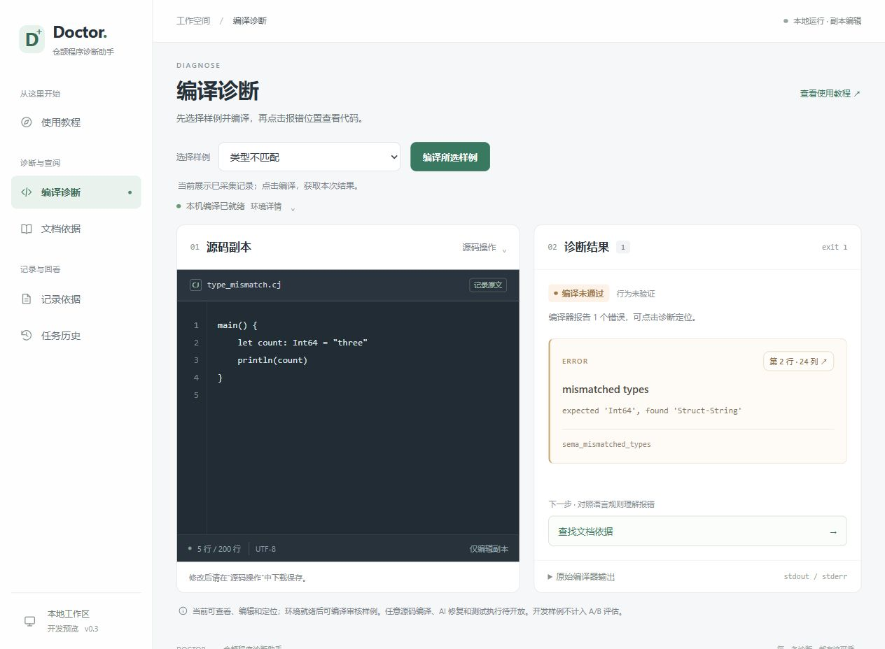

# Cangjie Code Doctor

仓颉程序诊断与测试验证工具，面向大学仓颉课程中的单文件练习。通过稳定的诊断、修改和测试流程，开展探索性 A/B 实验，回答：**加入同版本官方文档检索，程序修复成功率是否发生变化？**

当前为 0.3 开发版。固定 SDK 1.0.5 下已在 Linux 与本机 Windows 实际跑通：仓颉核心编译审核样例 → 解析 cjc → 保存快照和记录 → 本地 Web 接口及历史读取。任务接收与结束记录、异常、取消和超时可查原因并导出。2026-10-22 用户卸载 Windows 更新并重启后，原生启动恢复；中文仓库路径的命令行兼容问题已处理，详见环境记录。

离线文档依据已接通：仓颉核心用 BM25 检索固定版本的 15 段官方原文，界面展示引用并导出与诊断绑定的证据。使用教程和四项功能各有独立页面。本轮按“按钮太多、布局不清晰”的反馈收拢操作：选样例后编译、阅读报错、查找文档；文件、环境和证据详情按需展开。43 项本地检查及浏览器交互、环境异常、桌面与窄屏验收通过，详见[开发进度](docs/progress.md)。目前按“先完成离线功能”推进，模型服务与预算尚未选定。任意源码编译、AI 解释与修复、隔离验收、行为测试和正式 A/B 实验尚未完成。

主仓库：[AtomGit / GitCode](https://gitcode.com/A72316/cangjie-code-doctor)；同步副本：[GitHub](https://github.com/Frank72316/cangjie-code-doctor)。按课程要求，以主仓库作为提交与协作入口。

## 阅读入口

- [正式开题报告 PDF](docs/proposal.pdf) · [可编辑 Word](docs/proposal.docx)
- [项目说明与团队分工 PDF](docs/project-brief.pdf) · [文字版](docs/project-brief.md)
- [A/B 实验协议](docs/experiment-protocol.md)：案例划分、冻结、候选选择、判定及结果呈现。
- [与第三组的定位及合作说明](docs/positioning-and-collaboration.md)：各自的问题与证明方式，以及待协商的合作方向。
- [开发进度](docs/progress.md)：本次交付、实际验证、阻塞及后续顺序。
- [提交与同步记录](docs/submissions.md)：逐次提交、平台检查时间与老师核验入口。
- [官方文档来源与许可](docs/document-sources.md)：SDK 1.0.5 固定提交、15 段摘录、哈希与离线重建方法。
- [开发与复现](docs/development.md) · [Windows 环境排查](docs/environment.md)。

## 运行当前预览

在仓库目录的 PowerShell 中执行：

```powershell
./scripts/preview.ps1
```

然后打开 `http://127.0.0.1:8765`，首页进入“使用教程”。脚本优先使用系统 Node.js，其次查找本机 Codex 已有依赖；也可传 `-NodePath` 和 `-SdkRoot`。第一次使用按以下顺序操作：

1. 进入“编译诊断”，在“选择样例”下拉框选择“类型不匹配”，环境就绪后点“编译所选样例”。
2. 阅读右侧报错，点击行列位置查看对应源码。
3. 点击结果下方“查找文档依据”，在文档页点“检索文档”，直接用当前报错查找官方原文。

需要自行查询时再展开“自定义关键词（可选）”；填入关键词后，主操作区会提示此次使用自定义词。保存修改用诊断页“源码操作”中的“下载当前副本”；诊断记录的导入、导出统一在“记录依据”。本次真实编译可在“任务历史”回看，任务导出位于该条目的“任务详情与日志”内。

这些操作不需要模型 API 密钥。环境未就绪时仍可查看已有样例记录；重新编译和文档检索需要本机服务及对应原生环境可用。导入/编辑的任意源码只在浏览器内形成副本，尚不提交编译；修改后旧定位和文档依据失效，可用“恢复记录副本”返回已记录原文。所有生成程序均不执行，“编译通过”仍显示行为未验证。



界面采用左侧导航，每个功能有独立地址，右侧只展示当前页面：

| 页面 | 地址 | 内容 |
| --- | --- | --- |
| 使用教程 | `/tutorial`（首页 `/` 也进入此页） | 工具简介、首次操作步骤、功能入口与常见问题 |
| 编译诊断 | `/diagnostics` | 源码副本、样例编译与错误定位 |
| 文档依据 | `/documents` | 同版本官方文档检索、原文引用及证据导出 |
| 记录依据 | `/records` | 当前诊断记录的版本、状态、哈希及原始日志 |
| 任务历史 | `/history` | 历史任务、失败原因、进程日志及记录载入 |

可直接打开各地址，浏览器前进、后退与侧栏切换保持一致。左侧首项和 Doctor 品牌入口均可返回教程；教程先展示三步入门，详细五步操作、功能说明与常见问题可展开。教程中的功能入口只切换页面，不自动重置当前源码。同一页面会话内切换功能会保留源码编辑、诊断和检索结果；从历史载入诊断会返回“编译诊断”。刷新仍会重新载入初始数据，刷新前请下载修改后的源码与所需证据。窄屏采用顶部导航和单栏内容，中等宽度仍保留文字导航。

环境正常时详情折叠，异常时自动展开；“检查环境”位于其中，编译按钮旁的提示解释当前阶段或不可用原因。“恢复记录副本”只在副本变化后出现。文档首条原文默认展开，其余引用、来源许可、匹配信息及本次查询可逐项展开核对，完整证据仍可导出。

本轮预览：[编译诊断](docs/simplified-diagnostics.png) · [使用教程](docs/simplified-tutorial.png) · [文档依据](docs/simplified-documents.png) · [手机](docs/simplified-mobile.png)。历史预览保留供对照：[前版教程](docs/tutorial-preview.png)、[前版诊断](docs/pages-diagnostics.png)、[记录依据](docs/pages-records.png)、[任务历史](docs/pages-history.png)。

Windows SDK 1.0.5 开发命令（SDK 路径换成自己的安装位置）：

```powershell
./scripts/build.ps1 -SdkRoot 'D:\Cangjie'
./scripts/capture-examples.ps1 -SdkRoot 'D:\Cangjie'
./scripts/test-native.ps1 -SdkRoot 'D:\Cangjie'
```

构建与原生自检已在回退后的本机 Windows 通过。Linux CI 用于原生自检、样例编译、HTTP 联调及离线检索；各次实际结果见 [Actions 记录](https://github.com/Frank72316/cangjie-code-doctor/actions)。离线检索及前端接口检查的 Windows 命令如下；先加载 SDK 环境并完成构建：

```powershell
. 'D:\Cangjie\envsetup.ps1'
node scripts/test-retrieval.mjs target/debug/doctor.exe D:/Cangjie/bin/cjc.exe
node --test tests/*.test.mjs
```

完整联调和 Linux 本地启动方式见[开发说明](docs/development.md)。上述检查使用公开开发记录及明确标识的合成接口数据，不能作为修复成功率或正式 A/B 成绩。

## 工具与实验

交互流程：导入源码 → 编译与错误定位 → 有文档依据的解释 → 核对差异并确认修改副本 → 测试验证 → 回退、历史与报告。

本地 Web 界面和批量实验入口均为必交付。核心诊断解析、检索、调度、验证和记录使用仓颉实现，轻量 HTML/JavaScript 页面承担交互。第二周即联通界面与编译接口。CangjieMagic 为可选依赖，首周验证兼容性后决定是否采用。

首版限定固定 SDK、单文件 `.cj`、不超过 200 行、仅标准库及确定性标准输入输出测试。部署与验收暂以固定 Linux 容器环境为基线，首周验证后锁定；不承诺多平台隔离适配。

- [x] 审核样例的源码快照、行列定位和原始诊断展示
- [x] SDK 1.0.5 官方原文的离线 BM25 检索、引用展示与证据导出
- [x] 编译任务历史与异常、取消、超时记录
- [ ] 基于文档依据的模型解释与修复
- [ ] 候选校验、差异确认、最多两轮修复
- [ ] 受限编译与运行、公开测试比对、异常及超时处理
- [ ] 历史回退、JSON/HTML 报告和失败记录
- [ ] 冻结案例、批量 A/B、保留测试隔离与配对汇总

交互使用中由用户决定是否应用修改；主实验按固定规则选取候选，不加入人工改写或补充提示。两种模式分开记录。编译通过与测试通过分别展示；没有有效测试时显示“行为未验证”，通过测试不等于证明所有输入均正确。

## 受控 A/B 设计

| 项目 | 计划 |
| --- | --- |
| 案例 | 30 个：10 个开发，20 个评估；同源题目及变体放在同一划分 |
| 评估组成 | 16 个错误：语法、类型、作用域或接口误用、可编译逻辑错误各 4 个；另有 4 个正确回归案例 |
| A 组 | 题意、源码、公开测试、初始编译与测试结果 |
| B 组 | A 组输入，加同版本官方文档片段；初次检索片段在两轮内固定 |
| 控制条件 | 相同模型、参数、环境、输出上限、反馈及停止规则，每组最多两轮 |
| 默认预算 | 每个错误每组一次，计划最多 16 × 2 × 2 = 64 次生成；故障重跑另计并留档 |
| 成功判据 | 最终候选编译成功，且全部公开与独立保留测试通过 |
| 主结果 | 各组成功数 / 16、配对四种结果、成功率差值及成本 |

第六周冻结案例、文档、提示、参数、工具版本和规则；所有候选锁定后，才由独立入口使用保留测试。保留测试不进入模型、检索或人工候选选择，也不提前发布到公开仓库。

正向、接近和负向结果均完整呈现。若未观察到明确优势，如实说明并分析案例，不能删除不利结果或以界面体验替代 A/B 证据。16 个错误案例只支持本案例集、模型和环境下的探索性结论；不凭一次比例差宣称统计显著或普遍有效。工具可用性另用 10 个操作任务和拟邀请的 3—5 名学生试用检查。

## 团队与八周安排

| 成员 | 主要职责 |
| --- | --- |
| 张宇宸（组长） | 架构集成、文档检索、模型与候选校验、A/B 协议和预算 |
| 石澄錡 | 编译诊断、测试隔离、参考行为与保留测试、判定记录 |
| 高远 | 任务历史、本地 Web、定位与差异、回退报告、批量调度和配对汇总 |

| 周次 | 检查节点 |
| --- | --- |
| 第 1 周 | 明确问题，验证 SDK、模型和隔离，梳理第三组定位 |
| 第 2 周 | 联通界面定位，固定接口，准备开发案例与协议草案 |
| 第 3 周 | 文档检索与解释，统一两组输入和日志 |
| 第 4 周 | 贯通确认、测试、取消及原文件保护 |
| 第 5 周 | 完成两轮、回退、报告和批量汇总，复核案例 |
| 第 6 周 | 完成功能检查，冻结案例、配置、版本和判定规则 |
| 第 7 周 | 执行 A/B、锁定候选后验证，分析结果并试用 |
| 第 8 周 | 记录修复和复测影响，完成复现说明与答辩 |

具体日期随课程节点登记。三人共同复核案例、评审代码并审计记录。第三组以知识点、练习推荐和教师统计服务学习；本组以诊断修复流程和受控证据为核心。题库调用、真实错误样本和共同试用均为待协商方向，未形成合作承诺。

## 开发与数据约定

- 不提交 API 密钥、个人配置、个人路径或未经授权的源码。
- 隔离须经实测验证；验证前不自动执行任意模型候选，仅可受控演示逐份人工审核的可信样例。
- 待评估的保留测试存放于本地受限目录 `data/holdout/`，已加入忽略规则；不挂载给模型协调服务或检索进程。
- 公开材料和可复现记录须去除密钥与个人信息。保留测试公开与否单独审核，不能因结束运行就自动上传。
- 同步接口文档，标明开源复用范围、许可证和个人贡献。功能扩展不能挤占核心交互及实验控制工作。

## 两个平台的同步

`origin` 为 AtomGit / GitCode，`github` 为 GitHub；本地 `main` 跟踪 `origin/main`。目前通过分别推送保持一致，没有后台自动同步。每次实质性推进及时提交，并更新[开发进度](docs/progress.md)和[提交记录](docs/submissions.md)；GitHub CI 自动生成该次提交的验证摘要。

队友在主仓库提交 Issue、合并请求和评审。维护者在保存本地工作、确认已合并提交后同步：

```sh
git pull --ff-only origin main
git push origin main
git push github main
```

首次克隆的维护者可另加 GitHub 远程：

```sh
git remote add github https://github.com/Frank72316/cangjie-code-doctor.git
```

两边需要各自的推送权限。Git 推送同步指定分支的文件与提交历史，Issue、评论、合并请求和仓库设置不随之同步。若一边失败则处理后补推；分支出现分歧时先检查和合并，不强制覆盖队友提交。

## 参考入口

- [仓颉官方文档](https://cangjie-lang.cn/docs)
- [仓颉官方学习资源](https://cangjie-lang.cn/learn-resource)
- [CangjieMagic](https://gitcode.com/Cangjie-TPC/CangjieMagic)

README 更新日期：2026-10-22。正式报告与项目简介的材料修订日期仍为 2026-10-21；本轮记录离线实现进展，没有把功能检查写成实验结论。
