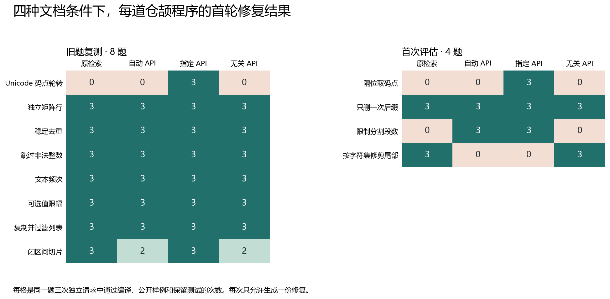

# 哪段文档能帮助模型修好仓颉程序？

2026 年 11 月 26 日，使用 SDK 1.0.5 和 DeepSeek Flash 完成 12 道题、四组、每组三次的一轮修复实验。把检索结果中的第三段换成按题指定的官方 API，模型在 36 次尝试中成功 33 次；换成长度接近的无关条目，成功 26 次。让系统用现有 BM25 自动选 API 时成功 26 次，保留原检索结果时成功 27 次。本轮观察到的收益集中在特定题目，自动替换第三段尚未带来总体改善。

## 怎样比较

沿用上一轮全部 8 道正式语言与 API 题，另外构造 4 道首次评估的字符串题。旧题用于解释已知现象，新题用于观察主题相近的另一种编程任务。每次都是新对话，模型只获一次修复机会。题意、初始错误代码、公开运行反馈、模型参数和前两段开发指南在组间相同。R 保留开发指南的第 3 名；M 换成标准库 API 索引第 1 名；G 换成事先指定的条目；P 换成长度接近的 Duration 条目。G 条目由研究者阅读题意后选择，不代表工作台已经具备这种选段能力。[预登记方案](protocol.md) · [付费前冻结的请求与顺序](design.json)

四道新题各有 2 项公开断言，共 29 项保留断言。模型调用前，独立运行原程序和参考实现；4 道题的原程序在两套测试中都暴露了错误，参考实现在两套测试中全部通过。8 道旧题沿用原有密封材料。随后一次性锁定 144 份回答，在固定 Linux 容器镜像中用原始公开入口和保留入口分别编译并运行。144 次公开执行中 112 次通过，18 次行为错误、14 次编译失败；112 次公开通过也全部通过保留测试。16 份材料报告和 256 份候选报告均已解密复核，逐项核对输入、源码摘要、镜像和容器清理。44 份不同完整源码的接口与示例硬编码由 Codex 辅助复核，无剔除。[材料运行](https://github.com/Frank72316/cangjie-code-doctor/actions/runs/45818797507) · [评分运行](https://github.com/Frank72316/cangjie-code-doctor/actions/runs/45820100788) · [复核记录](review.json)

## 结果

|第三段文档|旧题通过 / 24|新题通过 / 12|合计通过 / 36|一次通过率|输入 tokens|费用估算（元）|
|---|---:|---:|---:|---:|---:|---:|
|R 原指南第 3 名|21|6|27|75.0%|102615|0.253022|
|M 标准库 BM25 第 1 名|20|6|26|72.2%|85308|0.215680|
|G 按题指定的 API|24|9|33|91.7%|82656|0.209680|
|P 长度相近的无关 API|20|6|26|72.2%|82383|0.213118|

|配对比较|平均差（百分点）|按题重采样 95% 区间（百分点）|改善 / 持平 / 下降题数|
|---|---:|---|---|
|指定条目 − 无关条目|19.44|-13.89 至 50.00|4 / 7 / 1|
|自动 API − 原检索|-2.78|-27.78 至 22.22|1 / 9 / 2|
|指定条目 − 自动 API|19.44|0.00 至 41.67|3 / 9 / 0|

每题重复三次，按 12 道题等权进行配对分析。区间按预登记的旧题、新题两层重采样 10000 次，保留同一题内四组和三次重复。主比较 G−P 的区间跨过零。两道码点题还共享同一种 API，因此按题重采样未完全反映题型间的关联。成绩只说明这一小组任务上的表现。[逐题统计](summary.json)

## 三个可以回到代码核对的例子

**Unicode 码点。** 旧题要求左移字符串，新题要求取第 1、3、5 个码点。G 组拿到 `String.toRuneArray()` 条目后，两题各三份修复均实际调用该方法，六份全部通过。R、M、P 三组在这两题均继续使用按字节取值的 `toArray()`，共十八份全部失败。自动检索在旧题排首位的是用字节数组构造字符串的 `withRawData`，在新题排首位的是修剪开头字符的 `trimStart`。两题都已把正确方法收进索引，但各自的前三名均未选到。这个例子把问题定位到了排序环节。

**限制分割段数。** 新题要求保留空字段，并把剩余分隔符留在最后一段。M 正确排出 `String.split(String, Int64, Bool)`，与 G 拿到逐字相同的请求。两组都直接调用了带段数上限的重载，各过 3/3。R 和 P 的回答自行扫描字符或字节，各过 0/3。这道题直接展示了自动检索有用的条件。

**按字符集修剪尾部。** M 和 G 都收到 `String.trimEnd(String)` 的签名与说明，两组各过 0/3。阅读候选可见，模型没有调用这个重载，而是写了 `marks.contains(runes[end - 1])`；传入的 `Rune` 与方法所需的 `String` 不符，六份均编译失败。R 和 P 使用逐个码点比较的写法，各过 3/3。这里问题发生在模型使用文档的环节。不能据此判断模型为什么忽略条目。[逐次回答](candidates.json) · [逐次评分](score/receipt.json)

## 检索、费用与下一步

在 218 个官方 API 条目中，原生 BM25 把预先指定条目排在首位的题数为 4/12，进入前三的也为 4/12。这个指标只计预先指定的条目；其他可用方法不会算作命中。4 道命中题的 M、G 请求文本完全一致，闭区间切片仍分别得到 2/3、3/3，显示相同请求的输出也可能有波动。下一轮宜固定现有 12 题作为开发材料，通过区分“字节”和“码点”、方法参数类型和重载改进排序，再用未见过的 API 题单独评估命中率和实际修复率。对已命中的题可另做一次对照，只改变模型是否被要求核对所用方法的参数类型。

本轮 144 次真实调用的高峰非缓存估算为 **0.891500 元**，与此前三轮合计 **2.767942 元**，授权累计预算 20 元。G、P 输入总量分别为 82656 和 82383 tokens，相差约 0.33%；两组第三段并未逐题严格等长。在限制分割一题中，正文相差 260 个 UTF-8 字节。结果只涉及这版模型、这些任务和单次生成，不涉及学生学习效果或通用代理表现。[DeepSeek 官方定价](https://api-docs.deepseek.com/zh-cn/quick_start/pricing/)

## 复算与来源

- 用仓库根目录的 `node scripts/summarize-api-evidence.mjs` 从 [核对后的逐次数据](verified.json) 重算组别统计和区间。`py scripts/plot-api-evidence.py` 从 [summary.json](summary.json) 重画图。
- 本机保留钥匙可用时，`node scripts/audit-api-evidence.mjs` 可从密封行为证据重算逐次结果。`--materials` 单独验证新增题。不依赖模型再次生成。
- 标准库方法原文来自仓颉官方运行时 v1.0.5 提交 `c6aa169c` 的中文文档，Copyright © Huawei Technologies Co., Ltd. 2025，采用 CC BY 4.0。索引从指定类型中提取方法标题、签名和说明的连续行，省略长参数表及示例；每个条目都有上游文件行号。开发指南的首两段来自上一轮既有快照。[标准库上游](https://github.com/cangjielanguage/cangjie_runtime/tree/c6aa169ce8c6aaeb65cb1262bddb3700aebe8cb9/std/doc) · [源文件摘要](sources.json) · [条目及原文行号](corpus.json) · [上游许可证](UPSTREAM-LICENSE.txt)
