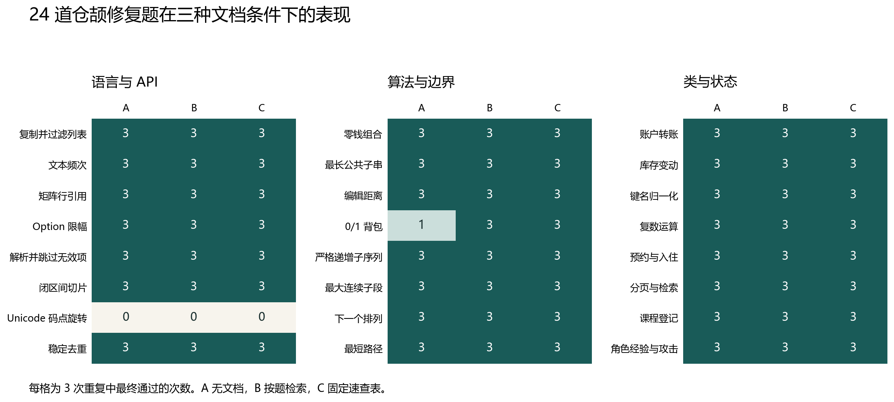

# 同版本文档检索对仓颉程序修复的影响

2026-11-26，DeepSeek Flash 在 24 道冻结评估题上完成三组配对实验。每题每组重复 3 次，最多修复两轮。按题检索的 B 组最终通过 69/72，无文档的 A 组通过 67/72，固定速查表的 C 组通过 69/72。B 和 A 的差异集中在一道背包题。相对于固定速查表，这批题上没有观察到按题检索的额外成功数。[预登记协议](../../../challenge-protocol.md) · [冻结设置](freeze.json)

## 修复结果

| 条件 | 首轮通过 | 第二轮调用 | 最终通过 | 最终通过率 | 总调用 | 估算费用（元） |
| --- | ---: | ---: | ---: | ---: | ---: | ---: |
| A 无文档 | 63/72 | 9 | 67/72 | 93.06% | 81 | 0.320560 |
| B 按题检索最多 3 段官方文档 | 68/72 | 4 | 69/72 | 95.83% | 76 | 0.674850 |
| C 每题相同的 3 段官方文档 | 69/72 | 3 | 69/72 | 95.83% | 75 | 0.651450 |

“通过”要求程序在 SDK 1.0.5 下通过编译、原题公开示例及冻结保留测试，并通过对目标接口和硬编码的复核。三组共享题目、初始诊断、模型参数和轮数。第二轮仅对公开阶段失败的 16 个条件发送各自的公开反馈，有 5 个转为完整通过。首轮 1 份回答格式失败，4 份编译失败，11 份公开行为失败。最终剩余 11 个条件均为行为失败。两轮所有 205 份公开通过候选也通过了保留测试，本次保留测试没有额外揭示失败。[逐条评分](scored/receipt.json)

每组的 72 项由 **24 道题 × 3 次重复**构成。主比较 B−A 的首轮差为 +6.94 个百分点，最多两轮后为 **+2.78 个百分点**。按题保留三次重复和全部组别，使用预登记种子重采样 10000 次，最终差值的探索性百分位 95% 区间为 **0.00 至 +8.33 个百分点**。B 比 A 在 1 题上表现更好，23 题持平。B 与 C 在 24 题上逐题持平，样本重采样自然始终为零，这些结果不足以证明两种文档策略普遍等效。[可重算比较](summary.json)

## 哪些题拉开了差距

| 分层（每层 8 题，各组 24 次） | A | B | C |
| --- | ---: | ---: | ---: |
| 语言与 API | 21/24 | 21/24 | 21/24 |
| 算法与边界 | 22/24 | 24/24 | 24/24 |
| 类与状态 | 24/24 | 24/24 | 24/24 |

**0/1 背包。** A 组三次中通过一次。另两次候选用 `cap..=weights[i]` 表达从大到小遍历容量，公开测试返回错误，第二轮仍保留该写法。B 和 C 各通过三次。检索组这道题拿到的是数组、类以及 ArrayList 的文档，并没有直接给出背包算法。观察到的差值支持报告这道题上的现象，不能据此把两次额外成功都归因于检索到了算法答案。

**Unicode 码点轮转。** 三组各重复三次，两轮之后九个条件全部失败。候选虽能编译，却用 `String.toArray()` 取出字节并逐项转成字符串，公开输出不满足按码点轮转的要求。B 组取回的两段字符串说明和一段 HashSet 说明都未提供 `toRuneArray()` 的用法。这是一处可以直接追溯到输入的检索缺口。

其余 22 道题的三组最终全部通过。开发集校准时 B 组对 A 组的优势出现在两道开发题上，独立正式集上最终差异集中到一道题。小型自建和改编题、较高通过率、单个模型和固定速查表的选择，都限制了结论的适用范围。本实验评估模型修复流程，学生使用效果需单独测量。

## 调用成本和证据

| 条件 | 输入 tokens | 输出 tokens | 单次请求耗时中位数 |
| --- | ---: | ---: | ---: |
| A | 54356 | 26481 | 1.20 秒 |
| B | 231557 | 26467 | 1.34 秒 |
| C | 221517 | 26052 | 1.31 秒 |

232 次真实请求共消耗 507430 个输入 tokens、79000 个输出 tokens，均返回了用量。按高峰非缓存价格估算 **1.646860 元**，实扣金额以服务商账单为准。B 虽比 A 少调用 5 次，估算费用高 0.354290 元。本样本每多一次最终成功，对应增加约 0.177 元。B 比 C 多花约 0.0234 元，最终成功数相同。既有先导实验与开发集校准估算 0.229582 元，三批实验合计 **1.876442 元**。[DeepSeek 官方定价](https://api-docs.deepseek.com/zh-cn/quick_start/pricing/)

生成在本机进行。公开检查和保留评分在同一 GitHub Linux 作业、同一固定镜像中进行。公开示例的执行入口取自原题。全部候选锁定后才执行保留验证。231 份格式有效的回答含 86 份不同源码，按题比对实现、检查声明和可疑硬编码后没有剔除候选，此项由 Codex 辅助完成。436 份报告由 231 份公开验证和 205 份保留验证组成，已核对源码、测试请求摘要、重复编号及容器清理状态。[Linux 运行记录](https://github.com/Frank72316/cangjie-code-doctor/actions/runs/45813407248) · [源码复核说明](review.json)

逐项请求身份、原始回答、公开反馈及评分结果见本目录。原始评分证据以压缩密文保存，钥匙留在本机。在仓库根目录运行 `node scripts/audit-development-calibration.mjs --formal` 可使用本机保留钥匙重算 [verified.json](verified.json)。运行 `node scripts/summarize-formal.mjs` 可由已核对的尝试重算组间统计，`py scripts/plot-formal-outcomes.py` 可生成逐题图。
