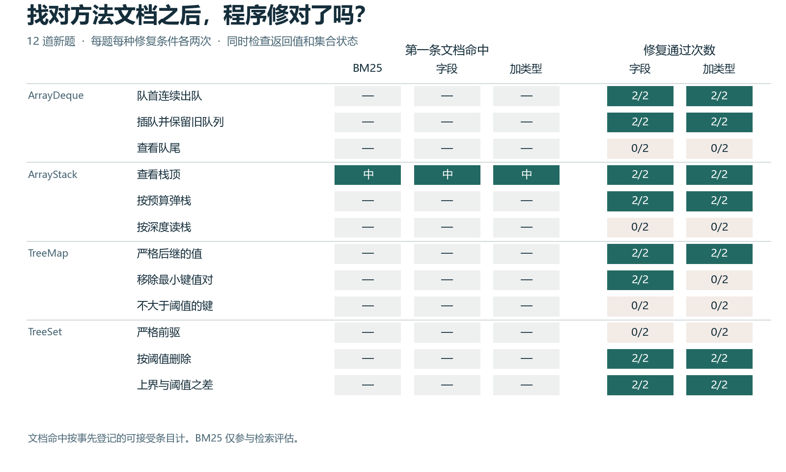

# 未见集合类型：找对文档所属的类，能多修对几道题？

在 12 道新题上，增加集合类型判断后，首条文档属于正确类型的题数从 **7 道升至 11 道**，但首条文档能直接支持所需操作的题数仍是 **1 道**。两轮重复合计，字段排序修复通过 **16/24**，加类型后为 **14/24**。观察到的两次差异来自同一道题。这轮没有给工作台采用这项排序改动提供修复收益方面的支持。

## 怎样检验

新写 12 道集合修复题，双端队列、栈、有序映射、有序集合各 3 道。这四类此前都没有进入研究使用的 API 语料。两组从同样的 203 段 SDK 1.0.5 官方文档中检索。F 沿用字段排序；T 额外读错误函数中的成员访问，当它指向唯一可识别的集合类型时，将该类文档放到前面。相同类型内的顺序完全继承 F。B 是原生 BM25 的离线检索参照。

F、T 各做 24 次真实 DeepSeek Flash 调用，每题两次。模型看到同一个错误程序、两组公开输入、初始执行反馈和两段通用指南。两份请求只有第三段 API 文档可能不同。每题另有 8 组保留输入，判定时同时比对函数返回值和调用后集合的完整内容及顺序。映射还检查键和值的配对。所有候选均由固定 SDK 的 Linux 容器实际编译；公开行为通过后再替换入口运行保留检查。按完整源码隐藏处理组共审阅 21 个版本。程序可以选择任何符合题意的实现，文档命中只按事先登记的直接相关条目计算。[预登记](protocol.md) · [公开任务](transfer.json) · [可接受条目及理由](labels.json)

## 两组实际修复

| 测量 | 字段排序 F | 加类型 T |
|---|---:|---:|
| 成功编译并通过公开例子 | 20/24 | 18/24 |
| 同时通过公开与保留检查 | 16/24（66.7%） | 14/24（58.3%） |
| 编译失败 / 公开行为失败 / 保留行为失败 | 2 / 2 / 4 | 4 / 2 / 4 |
| 八道文档完全相同的题 | 12/16 | 12/16 |
| 四道文档发生变化的题 | 4/8 | 2/8 |

所有差异集中在“删除最小键并返回它的值”。F 拿到 HashMap 的批量删除文档，两次生成都直接调用了可用的 `TreeMap.removeFirst()`。T 拿到同类型的 `TreeMap.remove(K)`，两次都写出先调用 `q.keys().first()` 再按键删除的方案。编译器报告键集合的接口没有 `first` 成员。这样的调用路径与提示内容吻合，但单题的两次回答不能证明模型总会受这一段文档误导。其余 11 道题的两组通过数相同。

分家族的通过数（每组各 6 次）为双端队列 4 比 4、栈 4 比 4、有序映射 4 比 2、有序集合 4 比 4。以四个家族为单位重采样，T−F 的探索性 95% 百分位区间为 −25.0 至 0.0 个百分点，观察差为 −8.3 个百分点。只有一个家族贡献差值，区间对单题很敏感。

两组共有 38 份候选通过公开例子，其中 8 份在保留输入的第一个空集合上触发 `NoneValueException`。这 8 份来自“最大的不大于阈值的键”和“严格前驱”两题。另有两种不同的失败：查看队尾的候选把 `last` 属性写成 `last()`，无法编译；按深度读栈的候选已经拿到按出栈顺序排列的数组，却反过来取下标，公开样例便能检出。[逐次审核记录](verified.json) · [隔离评分作业](https://github.com/Frank72316/cangjie-code-doctor/actions/runs/45940784953)

## 排名改在了哪里

| 12 道题 | 原生 BM25 | 字段排序 F | 加类型 T |
|---|---:|---:|---:|
| 第一条属于正确集合 | 10 | 7 | 11 |
| 第一条是可接受的方法文档 | 1 | 1 | 1 |
| 前三条至少一条可接受 | 4 | 3 | 5 |
| 第一条精确匹配首选方法 | 1 | 1 | 1 |

例如“查看队尾”要求返回最后一个号码，同时保留队列。F 选到栈的 `peek()`，T 改选双端队列的 `removeFirst()`。后者找对了集合，却会取走队首，方向和读写行为都与题意冲突。两组第一名正确的同是“查看栈顶”。“求上界与阈值之差”的原函数只有一条常数返回，没有成员访问，规则按预登记回退。两组共八题获得完全相同的模型请求，四题更换了文档。

## 参考程序的边界核验

第一次验收时，四份使用有序集合 `forward` 或 `backward` 的参考程序能过全部公开输入，却在保留测试的第一个空集合上抛出 `NoneValueException`。收据中四份报告的标准输出均为空，错误栈均包含对应方法。将四个参考改写为直接遍历比较后，12 个参考全部通过，12 个错误原程序均在两套测试上失败。两次的题目、输入、预期值逐项一致。这里的运行现象限于所测 SDK 和调用路径。[首次隔离验收](https://github.com/Frank72316/cangjie-code-doctor/actions/runs/45939796783) · [修正后验收](https://github.com/Frank72316/cangjie-code-doctor/actions/runs/45940171419)

## 一个不用模型的补充检查

看到主实验中“类型对了、方法仍错”后，单列七对短句。例如“取走键最小的一项”和“取走键最大的一项”共享同一段代码和同一类型，只有所求操作变化。14 句自然表述中有 2 句将目标排到第一，7 对中只有 1 对两句都对，另有 3 对的两句返回同一个首位。再把正确英文方法名直接加进查询，14 句中有 12 句命中，6 对两句都对。这个对照刻意提供了答案中的词，用于判断排序是否能识别方法名。它给下一轮留下一个可检验的改动：从题意区分“只读或移除、第一或最后、向上或向下”，再到全新任务上检查。[逐句查询和排名](intent-probe.json)

## 费用与适用范围

48 次付费请求全部返回有效格式，输入 93,400 tokens、输出 11,964 tokens。为与历次实验可比，按高峰非缓存价格保守估算本轮 **0.282512 元**，历次累计 **3.472668 元**。本轮实际请求发生于北京时间 12:31–12:32，输入中有 61,696 缓存命中 tokens、31,704 未命中；按空闲时段及缓存分档重算约 **0.08079 元**。两种数字均为估算，实扣以账单为准。[DeepSeek 定价](https://api-docs.deepseek.com/zh-cn/quick_start/pricing/)

题目、相关文档标签和测试由同一研究者编写，公开示例也会提供部分 API 用法线索。四个家族、一个模型和每题两次输出只支持本案例集内的探索性结论。对同一模型的重复生成不增加独立题数。文档命中衡量预登记条目；行为检查允许其他正确写法。本轮没有测量学生操作时间或学习效果。工作台继续使用现有检索。

## 复核入口

- `node scripts/freeze-api-families.mjs --families --verify` 从原生排名重建并校验 48 个模型请求，不调用模型。
- `node scripts/summarize-api-families.mjs --families --verify` 从已审核的逐次数据复算主结果、按家族重采样区间及保守费用。`node scripts/probe-family-intent.mjs --families --verify` 复算补充排名。
- 持有本机保留材料钥匙时，`node scripts/audit-api-evidence.mjs --families` 核对最终 48 份材料报告及 86 份候选执行报告，`node scripts/audit-family-boundaries.mjs --families --score` 核对首次验收的另外 48 份报告、测试未更改以及候选的保留异常。可用 `py scripts/plot-api-families.py` 重画逐题图。
