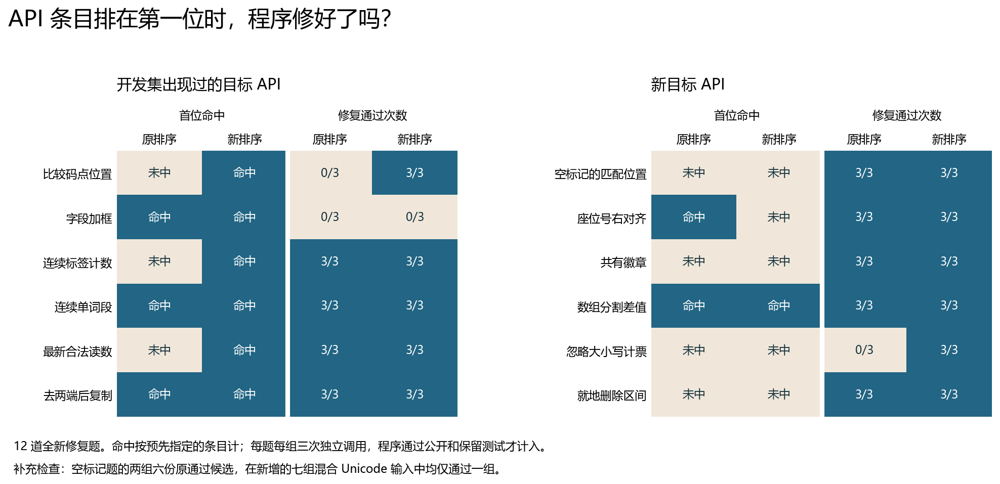

# API 排序能否提高仓颉程序的首轮修复率？

2026-11-27，DeepSeek Flash 在 12 道新题上各做 3 次首轮修复。按事先冻结的公开与保留测试评分，原生 BM25 通过 **27/36**，按题意、方法名和签名排序后通过 **33/36**。两道题各多通过三次，另外十题持平。针对其中一道持平题追加检查时，两组共六份原本通过的候选均暴露了 Unicode 边界错误。

## 实验怎么做

昨天的 12 道题全部用于开发。排序代码先提交，再写本轮的 12 道新题。6 道新题使用开发集出现过的目标 API，另外 6 道指定此前未标注的目标 API。每题在检索前标注一个能解决核心操作的 API。12 个目标条目互不相同。此次由同一研究者设计题目、标签和测试，没有独立人工标注者。[排序器冻结提交](https://github.com/Frank72316/cangjie-code-doctor/commit/eaa76ea) · [实验方案](protocol.md) · [公开题目](transfer.json) · [冻结标签](labels.json)

B 组沿用原生 BM25，使用题意、源程序标识符和初始诊断检索。F 组使用题意和函数签名，对方法名、标准库签名、说明的匹配赋予不同权重，并用一张固定的中英文词表连接“码点”和 Rune 等概念。两组均在相同的 218 条 SDK 1.0.5 API 文档中取第 1 名，作为模型收到的第三段文档。前两段指南、问题描述、源码、参数、模型均相同。全部 72 个请求在付费前锁定。同一题每组独立请求三次，每次仅生成一份修复，两组顺序交替。[算法代码](../../../scripts/rank-api-sections.mjs) · [冻结请求、来源与排序](design.json)

12 道题共 24 项公开断言、78 项保留断言。模型调用前，固定 SDK 镜像中的参考实现逐题通过两套测试，原始错误程序逐题在两套测试中暴露错误。模型回答锁定后，按原题入口和保留入口在 Linux 容器中独立执行。72 份回答格式有效，包含 31 份不同完整源码。按题隐藏组别审阅目标函数和示例硬编码，全部进入执行评分。公开阶段 60 份通过，7 份编译失败，5 份行为失败；公开通过的 60 份也全部通过冻结保留测试。48 份材料报告与 132 份主评分报告均核对了输入、源码摘要、镜像和清理状态。[材料验收](https://github.com/Frank72316/cangjie-code-doctor/actions/runs/45935928542) · [候选评分作业](https://github.com/Frank72316/cangjie-code-doctor/actions/runs/45936662022)

## 首位命中和实际修复

| 新题范围 | 首位命中 B → F | 前三命中 B → F | 冻结测试通过 B → F |
|---|---:|---:|---:|
| 开发集出现过目标 API 的 6 题 | 3/6 → 6/6 | 3/6 → 6/6 | 12/18 → 15/18 |
| 此前未标注目标 API 的 6 题 | 2/6 → 1/6 | 5/6 → 3/6 | 15/18 → 18/18 |
| 全部 12 题 | **5/12 → 7/12** | **8/12 → 9/12** | **27/36 → 33/36** |

首轮通过率从 75.0% 到 91.7%，样本差 **+16.67 个百分点**。按题配对并在两个层内分别重采样 10000 次，探索性 95% 百分位区间为 **0.00 至 +41.67 个百分点**。两个组各有 36 次尝试，统计单位是 12 道题。5 道题送入模型的请求在两组逐字相同。新方法对已见 API 的排序改善集中，而对新 API 的首位命中还少了一题；这批数据不足以支持全站改用新排序。开发集自己的首位命中为 4/12 → 5/12，前三为 4/12 → 7/12，单列用于说明开发过程。[逐项统计与配对区间](summary.json)

- **比较码点位置，0/3 → 3/3。** 原排序给出字符串比较方法，三份候选继续以字节为单位取值。新排序选中 `toRuneArray()`，三份候选都改按码点比较并通过。
- **忽略大小写计票，0/3 → 3/3。** 预先指定的是 `equalsIgnoreAsciiCase`，两组的首位都未精确命中。原排序给出 `toAsciiTitle()`，模型尝试自行转换字符，三份候选均未编译通过。新排序给出 `toAsciiLower()`，三份候选均用它将两侧转成小写再比较，全部通过。一个预先指定的标签会漏计这样的有效替代方法。
- **字段加框，0/3 → 0/3。** 两组选中同一带段数限制的 `split` 重载。候选中有的把上限多减了 1，有的手写扫描时比较了不兼容的字节与字符类型。即使检索准确，段数语义和参数类型仍可能用错。[原始回答](candidates.json) · [逐次评分](score/receipt.json)

## 追加边界检查发现了什么

阅读候选后发现，“空标记的匹配位置”一题的部分逻辑在查找**非空**标记时，仍按字节移动字符串切片。原保留样本包含中文与 emoji，但没有充分覆盖多字节字符和待找标记交错出现的位置。主评分前另行封存七组定向输入，用同一镜像检查参考实现和六份已锁定候选。这里的结果属于事后针对性检查。

参考实现 **7/7**。两组共六份候选在原冻结测试上全部通过，在新增七组输入上都仅通过 **1/7**。例如，在 `甲a` 中查找 `a`，六份都未通过期望值 1 的检查。若额外要求通过此题的七项检查，B、F 的总通过数分别为 **24/36、30/36**。主要比较的差值仍是 6 次。这一项不能估计其余十一题的漏测率，建议将这些用例保留为后续版本回归材料。[追加检查回执](score/probe.json) · [检查实现](../../../scripts/check-ranking-unicode-probe.mjs)

## 哪些排序改动值得继续检验

候选锁定前另做了不调用模型的离线拆分检查。在 12 道新题上，原生 BM25 只输入题意，首位仍为 5/12，前三从 8/12 降为 6/12。F 排序关闭形参类型加分后，12 道题的第一名逐题相同，前三精确命中数仍为 9/12。因此在这批题里，首位变化不能归因于目前这项类型加分；方法名加权和中英文词表各自的贡献还未单独测量。在“座位号右对齐”一题，原排序选中 `String.padStart`，新排序选中了与题面参数 `fill` 同名的 `Array.fill`。下一步可固定这 12 题作为开发材料，用完全不同的 API 家族测试对方法所属类型的约束，并为同一题预先标注多种有效解法。[离线拆分的逐题排名](ablation.json)

本轮 72 次调用，B 输入 80976、输出 6636 tokens，F 输入 79335、输出 6063 tokens。按高峰非缓存价，B 估算 0.215040 元、F 估算 0.207174 元，共 **0.422214 元**，与历次实验累计 **3.190156 元**，实扣金额以服务商账单为准。本次变更用于研究，工作台默认检索仍沿用原实现。[官方定价](https://api-docs.deepseek.com/zh-cn/quick_start/pricing/)

## 复算

在项目根目录运行 `node scripts/freeze-api-ranking.mjs --ranking --verify`，可用原生 Doctor 从冻结材料重新构建并核对 72 个模型请求。运行 `node scripts/summarize-api-ranking.mjs --ranking` 可从[已核对的逐次记录](verified.json)重算统计，`py scripts/plot-api-ranking.py` 重画图。本机持有保留钥匙时，`node scripts/audit-api-evidence.mjs --ranking` 可核对加密主评分证据，`node scripts/check-ranking-unicode-probe.mjs --ranking --audit` 可核对额外的七份报告。上述复算均无需重新调用模型。
