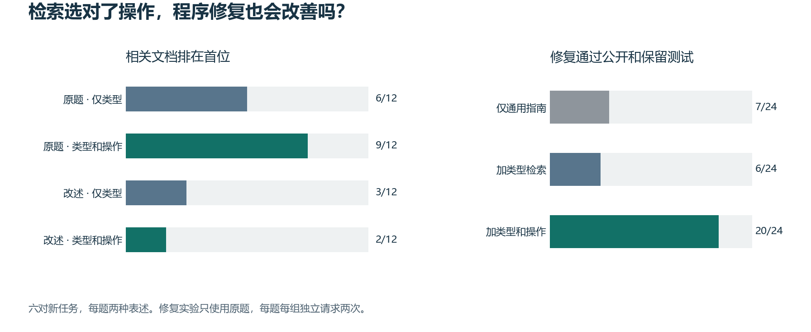

# 仓颉集合修复实验：理解操作与方向能帮多少忙？

在六对新编集合题的**原表述**上，DeepSeek Flash 拿到按操作和方向排序的 API 文档后，有 **20/24** 次修复通过编译、公开和保留测试。按集合类型选文档是 **6/24**，只给通用指南是 **7/24**。这批题的差异全部体现为编译能否通过。把相同任务改写成日常说法后，操作排序的首条文档命中从 **9/12** 降至 **2/12**。改述只做了检索评估，其修复效果仍未知。

## 哪些程序修好了

每对包含两道题，每题每组做两次，所以表中每格的分母均为 4。

| 操作对 | 仅指南 G | 加类型检索 T | 加类型和操作 I |
|---|---:|---:|---:|
| 查队首或队尾的票面差额 | 0 | 0 | 4 |
| 把两个标记接在队首或队尾 | 4 | 4 | 4 |
| 在匹配书签之前或之后插入 | 2 | 0 | 2 |
| 从链表一端取走若干项并按次序加权 | 0 | 0 | 4 |
| 报号后原地等候或离队 | 0 | 0 | 2 |
| 从最小或最大键的账目计算校验码 | 1 | 2 | 4 |
| **合计** | **7/24** | **6/24** | **20/24** |

I 与 T 相比，六对题中五对有改善，一对持平。实际改变文档的九题中，I 通过 16/18、T 通过 2/18。文档相同的三题两组均为 4/6。以任务对为单位精确枚举 46,656 种有放回重采样组合，I−T 为 +58.3 个百分点，探索性 95% 百分位区间为 +33.3 至 +83.3；I−G 为 +54.2 个百分点，区间为 +20.8 至 +87.5。六对均为定向选题，区间仅描述这一小批任务对的变化。[逐次结果](verified.json) · [统计明细](summary.json)

**一个能从源码和编译结果同时核对的例子。** 仓颉把双端队列的队尾声明为 `public prop last: ?T`。要读取它，应写 `q.last`，并处理可能为空的结果。按首选文档为 `first/last` 属性的四道题汇总，I 组 8 份回答都直接取对应属性，8/8 通过。G 和 T 各有 6 份把对应属性写成 `q.first()` 或 `q.last()`，这 12 份全部编译失败。其余份数采用了不同写法，G 在四题中共过 1/8、T 共过 2/8。这个次要分析在候选生成后确定，仅检查目标函数中对形参 q 的直接访问。它展示了模型输出具体改在哪里。[官方队尾属性](https://github.com/cangjielanguage/cangjie_runtime/blob/c6aa169ce8c6aaeb65cb1262bddb3700aebe8cb9/std/doc/libs/std/collection/collection_package_api/collection_package_class.md#L38-L46) · [逐份属性写法与判定](property-use.json)

**还有两种值得区分的情况。** 链表尾部加权题中，I 给的是队首删除文档，方向仍错，但这段文档说明移除返回可空值。I 两份回答都改用队尾并处理空值，两份都过；T 两份直接拿可空值做乘法，均未编译通过。这是对输出差异的可能解释，单题无法分离文档中每条信息的贡献。反过来，“报号后离队”中，两组都拿到了出队文档，但还需要另一项有效操作先读队首；I 在该题两次均未通过。所有组共 39 份在编译时失败，另外 33 份均通过公开和保留检查。在这批任务里，保留检查没有额外淘汰候选。[实际编译与行为评分](https://github.com/Frank72316/cangjie-code-doctor/actions/runs/45943590354)

## 研究设计

一共六对任务、12 道题。每对共享相同的错误函数体，两份题面改变目标方向或对集合的影响。例如同一个叫号函数，可以要求“报号后继续排队”，也可以要求“报号后离队”。任务覆盖双端队列、链表、普通队列和有序映射。每题还有一份作者写的日常语言改述。案例和改述由同一人编写，属于针对已知问题的探索性评估。[预登记](protocol.md) · [公开程序](transfer.json) · [标注理由和改述](labels.json)

三组使用同一 DeepSeek Flash、SDK 1.0.5、错误程序、公开行为反馈和两条通用指南。G 到此为止。T 再给一段优先匹配集合类型的 API 文档。I 也给一段，在 T 的基础上根据题意重排读写方式和方向。T、I 两个请求删除第三段后与 G 逐项相等。每题每组独立调用两次，不用模型重试。改述仅评估检索，模型修复使用原题。评分检查函数输出和调用后的完整集合，模型可以采用任何符合契约的解法。

六对任务先锁错误程序、参考程序、可用文档和保留断言，再在固定 SDK 的 Linux 容器验收。首次验收通过后，额外检查发现书签前插和后插的两个公开样例都没有找到书签。为让公开样例能区分两边，在模型生成之前把一个样例换成有两个匹配节点的输入，同时保留未匹配样例，所有保留断言及两边的算法均保持一致。复验后 12 个错误程序在公开和保留检查均失败，12 个参考程序均通过。每题有 2 组公开输入和 10 组保留输入。[首次材料验收](https://github.com/Frank72316/cangjie-code-doctor/actions/runs/45942225766) · [最终材料验收](https://github.com/Frank72316/cangjie-code-doctor/actions/runs/45942634542)

## 原题与改述的差异

| 检索指标 | 仅类型 T | 类型加操作 I |
|---|---:|---:|
| 原题首条可接受 | 6/12 | 9/12 |
| 原题前三条可接受 | 9/12 | 12/12 |
| 原题首条精确匹配首选方法 | 4/12 | 9/12 |
| 原题同一对的两个目标均首条命中 | 2/6 | 4/6 |
| 改述首条可接受 | 3/12 | 2/12 |
| 改述前三条可接受 | 4/12 | 2/12 |
| 原题及其改述均首条命中 | 2/12 | 2/12 |

这里的“可接受”指预先标注为对核心操作有用的方法，可能有多个。例如要按条件出队，先查看队首也有帮助，却不足以单独完成删除。所以另列“首选方法”。在上轮已知的 14 句开发材料上，新规则首条精确命中 14/14，原类型排序为 2/14。新题的两种表述揭示了开发材料没有覆盖的用法。

看到主排名后，另将六个题面各改一个短语，不调用模型、不改主试成绩。“从尾部取走，**第一个**取走的值乘 1”中的序号被误当成队首方向。改为“每项乘以它被取走时从 1 起算的序号”，便从删除队首排到删除队尾。另一个例子是“**乘客依次进入队列**，请报出……”，背景句误触发插入动作。删去背景句后，两道题均退出插入分支，但仍只有一道找到正确端点。书签题中，“第一个匹配节点”同样不等于“链表第一个节点”。这些现象说明规则还需要区分动作的对象、背景叙述和计算次序。[补充改句、识别结果与排名](wording-probe.json)

## 复核与适用范围

第一次隔离评分遇到工具错误后停在公开检查，当时的日志未保留完整诊断，具体原因未能确认。加上加密的中断证据保存后，对同一批候选和测试从头重跑成功，核对 48 份最终材料执行报告和 105 份候选执行报告。评分重跑没有调用 DeepSeek。此前的 48 份初版材料报告单列归档。[中断记录](https://github.com/Frank72316/cangjie-code-doctor/actions/runs/45943172736) · [完成评分](https://github.com/Frank72316/cangjie-code-doctor/actions/runs/45943590354)

本轮 72 次请求，输入 149,804 tokens，输出 20,050 tokens。沿用历次高峰非缓存口径，本轮估算 **0.460008 元**，累计 **3.932676 元**。实际生成在北京时间 12:57–12:59，按空闲时段及 112,638 个缓存命中输入 tokens 重算约 **0.11962 元**。实扣以账单为准。[DeepSeek 定价](https://api-docs.deepseek.com/zh-cn/quick_start/pricing/)

这些结果适用于单一模型、固定 SDK 和明确设计的操作对。它们支持在原题这类表述下检索带有准确 API 签名的文档。面向学生开放输入时，接下来的独立评估需要使用学生自己写的描述，尤其要覆盖背景叙述、口语和一个任务包含两种操作的情况。本次没有测量学生学习效果。工作台沿用现有默认排序。

在仓库根目录可运行以下检查，均无需调用模型。

- `node scripts/freeze-api-operation.mjs --operation --verify` 使用可信仓颉核心复算 72 个请求及排序。
- `node scripts/summarize-api-operation.mjs --operation --verify` 复算检索、修复、费用和按任务对重采样区间。
- `node scripts/inspect-operation-properties.mjs --operation --outcomes --verify` 和 `node scripts/probe-operation-wording.mjs --operation --verify` 核对属性用法和改句对照。
- 持有本机保留材料钥匙时，`node scripts/audit-api-evidence.mjs --operation` 核对最终隔离证据。`py scripts/plot-api-operation.py` 可重画对比图。
