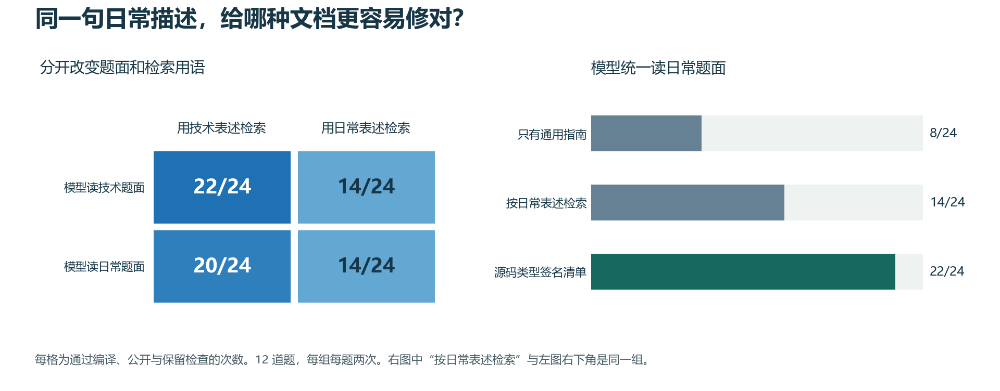

# 学生用日常语言提问时，给模型哪种仓颉文档？

同样让 DeepSeek Flash 阅读日常表述，12 道集合题各修两次。模型只拿到两条通用指南时通过 **8/24** 次，另给一段按日常表述检索的 API 文档时通过 **14/24** 次，按错误源码的集合类型给出官方成员签名清单时通过 **22/24** 次。清单组有 11 道题两次都通过，一道题两次都失败。这 12 道题的日常表述由研究者编写，尚无学生参与。

## 题面和文档分别贡献了多少

拿“最近入列者的票面数”举例。模型读到的始终是这句话。按它检索，第一条文档是往队首加元素的 `addFirst`，两份回答都写了 `q[q.size - 1]`，仓颉编译器报告双端队列不支持这种下标。检索端换用原题里的“查看队尾”，第一条文档变成队尾属性 `last`，两份回答都改成取 `q.last` 并处理可空值，公开和保留检查均通过。直接从源码认出 `ArrayDeque` 并列出它的成员签名，也得到两次通过。[锁定的模型回答](candidates.json) · [官方队尾属性](https://github.com/cangjielanguage/cangjie_runtime/blob/c6aa169ce8c6aaeb65cb1262bddb3700aebe8cb9/std/doc/libs/std/collection/collection_package_api/collection_package_class.md#L38-L46)

在全部题上固定模型读到的日常表述，仅换为技术表述检索出的文档，总通过数从 14 变为 20。反过来，固定这份技术表述选出的文档，只把模型看到的题面由日常换成技术表述，通过数从 20 变为 22，两次差额均来自书签题。固定日常表述选出的文档时，两种题面总数同为 14，逐题仍有差异。技术表述由研究者配对提供，只用于分离变量。

| 组 | 模型题面与补充材料 | 通过 | 编译失败 | 公开输出错误 | 保留检查失败 | 平均输入 tokens |
|---|---|---:|---:|---:|---:|---:|
| FF | 技术表述，按技术表述检索 | 22/24 | 2 | 0 | 0 | 1865 |
| FN | 技术表述，按日常表述检索 | 14/24 | 10 | 0 | 0 | 1879 |
| NF | 日常表述，按技术表述检索 | 20/24 | 3 | 1 | 0 | 1868 |
| NN | 日常表述，按日常表述检索 | 14/24 | 8 | 2 | 0 | 1882 |
| NS | 日常表述，给源码类型的成员签名 | 22/24 | 2 | 0 | 0 | 1993 |
| NG | 日常表述，只给通用指南 | 8/24 | 14 | 2 | 0 | 1707 |

144 份回答中，39 份编译失败，5 份编译成功但公开输出错误，100 份通过公开检查，也通过保留检查和源码契约复核。每道题的公开入口包含两组输入，保留入口另含十组。评分比较返回结果和调用后的集合状态。[逐次结果](verified.json) · [评分收据](score/receipt.json)

## 哪些任务有改善，哪里仍会失败

每对任务包含两道题，每题每组两次，下表每格的分母为 4。编号含义见上表。

| 操作对 | FF | FN | NF | NN | NS | NG |
|---|---:|---:|---:|---:|---:|---:|
| 读取队首或队尾票面差额 | 4 | 0 | 4 | 0 | 4 | 0 |
| 把两个标记接在队首或队尾 | 4 | 4 | 4 | 4 | 4 | 4 |
| 在匹配书签的左边或右边插入 | 4 | 3 | 2 | 1 | 2 | 2 |
| 从链表一端收牌并按次序加权 | 4 | 2 | 4 | 1 | 4 | 0 |
| 报号后原地等候或离队 | 2 | 4 | 2 | 4 | 4 | 0 |
| 从最低键或最高键的账目算校验码 | 4 | 1 | 4 | 4 | 4 | 2 |

- **签名清单最明显的收益在查车票和取牌加权。** 相对按日常表述取单段文档，查车票从 0/4 到 4/4，取牌加权从 1/4 到 4/4，两对贡献了八次净增中的七次。尾端收牌题中，两份单段文档组回答都拿 `removeLast()` 的可空返回值直接做乘法，均编译失败。签名清单组两份回答都先解开可空值，均通过。
- **书签题保留了反例。** 把书签插到匹配项左侧时，签名清单组两次都选对了 `addBefore`，但用 `n.value` 去访问仍为 `Option` 的节点，编译失败。仅通用指南的两份回答都采用遍历、重建链表的办法，两次通过。按日常表述选单段文档通过 1/2 次。查到方法名也可能卡在参数类型和可空值用法上。
- **只给一段文档还可能漏掉另一项操作。** “达到门槛才离队”先要看队首，再决定是否删除。技术表述选出的单段文档是删除方法 `remove()`。模型在日常题面下两次都写了这个类型没有的 `q.first`，均编译失败。日常表述选出的是 `peek()`，两份回答都结合 `peek()` 和 `remove()` 通过，签名清单组也两次通过。

## 配对估计和适用范围

以下差值以百分点计。六对相关任务是重采样单位，每对等权。枚举 46,656 种有放回抽样，计算描述性 95% 百分位区间。表中“升 / 平 / 降”按任务对统计。12 道题中有 11 道在切换检索表述时换了首条文档。仅在这 11 道内，NF 通过 18/22、NN 通过 12/22；剩下的那道两组都是 2/2。[完整统计](summary.json)

| 比较 | 差值 | 95% 重采样区间 | 升 / 平 / 降 |
|---|---:|---:|---:|
| 日常题面下换用技术表述选出的文档（NF−NN） | +25 | -12.5 至 +66.7 | 3 / 2 / 1 |
| 固定技术表述选出的文档，改变模型题面（FF−NF） | +8.3 | 0 至 +25 | 1 / 5 / 0 |
| 日常题面下改给类型签名清单（NS−NN） | +33.3 | +4.2 至 +66.7 | 3 / 3 / 0 |
| 日常表述选出的文档相对仅通用指南（NN−NG） | +25 | -4.2 至 +58.3 | 3 / 2 / 1 |
| 技术题面下更换文档（FF−FN） | +33.3 | -8.3 至 +70.8 | 4 / 1 / 1 |
| 固定日常表述选出的文档，改变模型题面（FN−NN） | 0 | -33.3 至 +29.2 | 2 / 3 / 1 |
| 两种题面下，更换检索文档的效果之差 | +8.3 | -12.5 至 +37.5 | 1 / 4 / 1 |

实践上可以在认出单一集合类型时，同时提供属性、方法参数和返回类型，让学生保留自己的说法。在本组任务里，这张清单比日常表述检索出的单段文档平均多用约 111 个输入 tokens（约 5.9%）。清单同时改变了条目数量、文档格式和长度，各因素的独立贡献仍未知。四种集合在固定语料内各有 12 至 28 条声明。跨多个类型、识别不出接收类型的程序，以及真实学生的提问，都是这批题尚未覆盖的情况。研究脚本保留类型不确定时的回退逻辑。[签名选择实现](../../../scripts/collection-signatures.mjs)

## 研究和复算记录

先登记六种条件，再冻结请求，并在评分前锁定全部候选。沿用上轮 12 道题、24 组公开输入、120 组保留输入及 48 份材料验收报告。六组使用同一 SDK 1.0.5、同一系统消息和 DeepSeek Flash 参数，每题均给相同的源码、公开反馈及两条通用指南。两次调用均为独立请求，温度 0，关闭思考，最大输出 4096 tokens。六种条件在每个调用位置各出现四次。组别遮盖后单人审阅了 67 份不同完整源码，随后在固定 SDK 的 GitHub Linux 容器评分，复核 244 份候选执行报告。一次公开检查通过才继续执行该候选的保留检查。[预登记](protocol.md) · [已冻结输入](design.json) · [盲审记录](review.json) · [材料验收](https://github.com/Frank72316/cangjie-code-doctor/actions/runs/45942634542) · [隔离评分](https://github.com/Frank72316/cangjie-code-doctor/actions/runs/45958086396)

北京时间 2026-11-27 15:16 至 15:20 完成 144 次调用。输入 268,644 tokens，输出 40,687 tokens。沿用历轮高峰非缓存口径，本轮保守估算 0.862784 元，累计 4.795460 元。实际时段有 196,477 个输入 tokens 命中缓存，按公开高峰价重估本轮约 0.477689 元，具体实扣以账单为准。[DeepSeek 定价](https://api-docs.deepseek.com/zh-cn/quick_start/pricing/)

在仓库根目录可离线核对结果。第一条需要已构建的可信仓颉核心，第三条需要本地保留材料钥匙。

- `node scripts/freeze-api-wording.mjs --wording --verify` 复算六组请求、文档与调用顺序。
- `node scripts/summarize-api-wording.mjs --wording --verify` 复算次数、逐题配对区间和费用。
- `node scripts/audit-api-evidence.mjs --wording` 复核材料、请求、源码、容器清理、评分和盲审。
- `py scripts/plot-api-wording.py` 从汇总结果重画图表。
