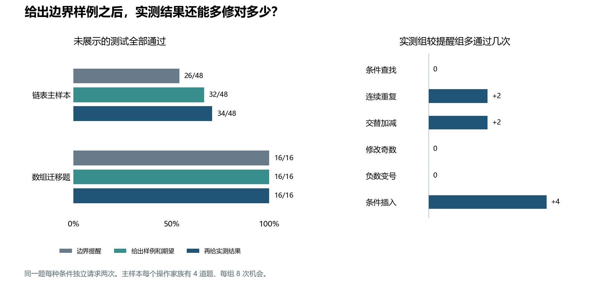

# 边界样例、正确期望和实测反馈，各能帮助修对多少？

24 道仓颉链表题每组各复查两次。**只提醒检查边界通过 26/48，给出一个样例及其正确期望通过 32/48，再给初稿的实测输出通过 34/48。** 从提醒到完整反馈多通过 8 次，分布在 4 道题。知道期望后再看实测，净增的 2 次都来自同一道题。新增 8 道数组题三组均为 16/16，简单复查已达满分。本轮共 192 次独立模型调用。

## 怎样区分样例和实测反馈的作用

对每份初稿，H 组请模型检查边界。S 组增加一个具体输入和应该得到的返回值、最终序列。R 组在 S 的完全相同输入上增加初稿实际返回的值和序列。初稿编译失败时，R 只得到真实失败状态。H、S、R 都能看见相同的原公开样例反馈。链表 H 组的整个请求与上轮边界提示逐字节相同，本轮重新调用。每题每组各请求两次，交错调用，顺序在第二遍逆转。DeepSeek Flash 温度为 0、关闭思考。模型没有收到保留输入、保留成绩或参考代码。[预登记](protocol.md) · [冻结的请求](design.json)

主样本取上轮同样的 24 份链表模型初稿，展示空表。新增 8 道数组题，展示“唯一元素恰好等于阈值”的输入。数组初稿由研究者编写，其中 2 份从一开始就正确。每题另设 18 条保留断言，同时核对返回值和最终元素序列。每道题均核对了完整输入去重，链表题也与此前两轮去重。相似的边界类别仍会在测试中出现，因此另外计算了只看其他长度类别时的成绩。配对题共享输入，按题合计 576 条断言。[公开材料](transfer.json) · [32 个诊断样例](probes.json) · [SDK 材料验收](https://github.com/Frank72316/cangjie-code-doctor/actions/runs/46120854726)

## 看懂一道真正拉开差距的题

整表向左交替加减题要求从表尾向左计算。函数虽然接收位置标记，题意明确说该参数供其他功能使用。给出的例子是空表、标记为空、阈值为 37。没有元素可加减，期望返回 `0`，初稿实测返回 `-999`。

只给样例和期望的两份回答都把提前返回值改成了 `0`。空表示例过了，但有元素、标记为空时，代码仍直接返回 `0`，跳过了整张表。再给实测结果的两份回答都删掉了这个多余分支，从表尾正常遍历，18 个保留输入全部通过。这是 R 比 S 多通过的唯一一道题。对方向反过来的对应题，R 组仍保留了错误分支，两次都只过了展示样例。这里可以看到两种补丁的差别，模型内部采用它们的原因仍无法从结果判定。[候选源码](candidates.json) · [真实评分](https://github.com/Frank72316/cangjie-code-doctor/actions/runs/46121958249)

## 完整修复与只修对样例

| 题集 | 复查时可见的信息 | 全部通过 | 相对初稿改对 | 相对初稿改坏 | 展示样例通过 | 只过展示样例且未全过¹ | 不同长度类别通过² |
|---|---:|---:|---:|---:|---:|---:|---:|
| 链表主样本 | 边界提醒 | 26/48 | 6 | 0 | 26/48 | 0 | 30/48 |
| 链表主样本 | 再给样例和期望 | 32/48 | 12 | 0 | 36/48 | 4 | 32/48 |
| 链表主样本 | 再给同一样例的实测输出 | 34/48 | 14 | 0 | 36/48 | 2 | 34/48 |
| 数组迁移题 | 边界提醒 | 16/16 | 12 | 0 | 16/16 | 0 | 16/16 |
| 数组迁移题 | 再给样例和期望 | 16/16 | 12 | 0 | 16/16 | 0 | 16/16 |
| 数组迁移题 | 再给同一样例的实测输出 | 16/16 | 12 | 0 | 16/16 | 0 | 16/16 |

¹ “只过展示样例”列统计已通过原公开检查和展示样例、仍在保留测试失败的回答。展示样例单独运行，不计入主指标。² 链表只看非空输入，数组只看长度不等于 1 的输入，也要求通过原公开检查。该列与主指标的差值反映去掉展示长度类别后的变化。[逐条保留输出的分类结果](holdout-traces.json)

链表初稿 10/24 题全部通过，数组初稿 2/8 题全部通过。三组均保住了这些正确初稿。链表 R 对 H 的差值是 8/48，即 16.7 个百分点；其中 S 对 H 为 6/48，R 对 S 为 2/48。R 与 S 在 48 个同题、同轮次配对中有 36 对返回完全相同的源码。数组面板 16 个配对的三组代码逐一相同。这组数组题存在明显的满分效应，未能判断较困难的数组题是否也受益。[输入配对、相同源码和执行一致性](agreement.json)

| 链表操作 | 提醒 | 样例和期望 | 额外实测 | 额外实测较提醒 | 去掉本家族后的 R−H |
|---|---:|---:|---:|---:|---:|
| 条件查找 | 4 | 4 | 4 | 0 | +8 |
| 连续重复 | 4 | 6 | 6 | +2 | +6 |
| 交替加减 | 4 | 4 | 6 | +2 | +6 |
| 修改奇数 | 8 | 8 | 8 | 0 | +8 |
| 负数变号 | 6 | 6 | 6 | 0 | +8 |
| 条件插入 | 0 | 4 | 4 | +4 | +4 |

R 相比 H 在连续重复、交替加减和条件插入三类多通过。在六类操作中任意去掉一类，另外五类仍合计多通过 4–8 次，分母相应变为 40。按题看，R 较 H 是 4 题改善、20 题持平；R 较 S 是 1 题改善、23 题持平。这里没有把同题的两次调用当成两个独立问题。

**测试有多少机会区分更一般的修复？** 在评分期间另做一项只读初稿证据的反事实计算：假定展示长度的所有输入都被修对，其他输入保持初稿实测结果。这样链表已有 15/24 题能全过，比初稿多 5 题；数组仍是 2/8。链表三组只看非空输入时分别为 30、32、34 次通过，R 对 H 的差值从 8 缩小到 4。这也是同时报告全套和不同长度测试的原因。[补充计算及逐题判定](shape-control.json)

## 在工作台里，什么时候值得调用模型？

| 初稿在额外样例上的表现 | 题数 | 提醒后全部通过 | 给期望后全部通过 | 再给实测后全部通过 |
|---|---:|---:|---:|---:|
| 通过 | 10 | 20/20 | 20/20 | 20/20 |
| 实际值与期望不同 | 12 | 6/24 | 12/24 | 14/24 |
| 未取得运行数值 | 2 | 0/4 | 0/4 | 0/4 |

在同一批实测组回答上回放三种规则。只在触发条件满足时使用该次复查稿，否则保留初稿。判断条件只用当时可见的公开结果。表中模拟调用次数反映部署这条规则的用量，实验实际执行的 192 次请求已单独计费。[调用前锁定的回放规则](policy-plan.md)

| 题集 | 调用条件 | 模型调用次数 | 最终全部通过 | 保守模型费用（元） |
|---|---:|---:|---:|---:|
| 链表主样本 | 只看原公开样例 | 12 | 20/48 | 0.0631 |
| 链表主样本 | 原公开或额外样例失败 | 28 | 34/48 | 0.1390 |
| 链表主样本 | 每次都复查 | 48 | 34/48 | 0.2474 |
| 数组迁移题 | 只看原公开样例 | 0 | 4/16 | 0.0000 |
| 数组迁移题 | 原公开或额外样例失败 | 8 | 12/16 | 0.0210 |
| 数组迁移题 | 每次都复查 | 16 | 16/16 | 0.0421 |

链表上，多跑一个空表样例后，只复查公开或额外样例失败的初稿，28 次调用保住了全部复查的 34/48，省下 20 次调用。数组上，同一规则省下 8 次调用，却把通过数从 16/16 降为 12/16。漏掉了两道初稿：一个程序本该返回最后一个匹配位置，却返回第一个；另一个本该只修改第一个匹配项，却修改了全部。只给一个元素时，这两种错误都不会暴露。对“第一个、最后一个、只改一次”之类的题，多个位置同时符合条件的输入更有诊断价值。这是从当前结果得出的下一项验证方向。[逐题成绩](summary.json)

## 证据、费用与适用范围

材料阶段有 192 份 SDK 执行报告，候选评分有 504 份。评分前遮盖组别审阅了 46 份不同源码，所有回答都通过了格式检查并进入总分母。对重复源码的 45 组执行，公开、展示与保留判定均一致；81 次原样交回初稿，重评的最终判定也都与基线一致。Python 从归档请求和评分收据独立复算。[材料收据](materials/receipt.json) · [盲审记录](review.json) · [评分收据](score/receipt.json)

主样本是刻意研究过的一组链表题。12 份在空表上能运行却给错结果的初稿，实际都返回了同一个占位值 `-999`，因此样例可以非常直接地点出这类错误。新增数组题具有另一种输入形态，但只有四类操作，且由同一研究者编写、审阅。正确的样例期望来自研究材料，现实中的学生或工具能否给出同等质量的期望，需要另测。重复调用共享题目和起点，本轮不据此推断学生群体的效果。

本轮输入 201,824 tokens，其中 163,445 命中缓存，输出 57,416 tokens。按历轮统一的高峰无缓存口径，本轮估算 **0.862976 元**，历轮累计 **7.404568 元**。按当日周末定价与缓存命中量，本轮估算约 0.271312 元，实际扣费以平台账单为准。运行样例的工程成本未计入模型费。[DeepSeek 官方定价](https://api-docs.deepseek.com/zh-cn/quick_start/pricing/)

## 怎样复核

仓库根目录下，`node scripts/freeze-feedback-study.mjs --feedback --verify` 检查三组输入和调用顺序，`node scripts/summarize-feedback-study.mjs --feedback --verify` 与 `py scripts/check-feedback-study.py` 分别从归档和原始评分收据复算。后者还核对了生成与评分提交中的文件版本。`node scripts/feedback-agreement.mjs --feedback --verify` 可复算相同源码和配对结果，`py scripts/plot-feedback-study.py` 可重画图表。

持有本地保留材料钥匙时，`node scripts/check-feedback-fixtures.mjs --feedback` 校验输入去重和独立预期值。`node scripts/audit-api-evidence.mjs --feedback` 解密核对源码、测试、SDK 镜像、状态及容器清理记录。`node scripts/trace-feedback-holdout.mjs --feedback --verify` 和 `node scripts/feedback-shape-control.mjs --feedback --verify` 核对长度类别分析。[评分收据](score/receipt.json) · [逐条判定](verified.json) · [逐题统计](summary.json)
