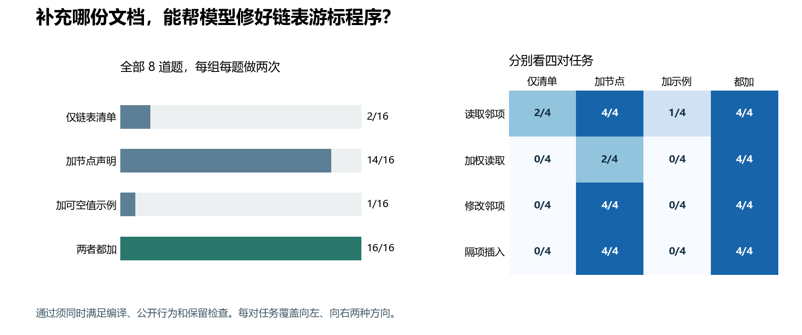

# 当错误发生在链表节点上，给哪份文档最有帮助？

在 8 道新编仓颉游标题上，每题用 DeepSeek Flash 独立修两次。只给链表成员清单，16 次中通过 2 次。追加节点的三个属性声明后，通过 14 次。单独追加通用可空值示例，通过 1 次。两者都给时通过 16 次。通过要求程序能编译，返回值和修改后的整张链表都符合公开及保留检查。

## 对照怎么做

四组共用同一张 LinkedList 成员清单、同一个错误函数、日常语言题面、公开用例和原程序反馈。所有题都接收一个可能为空的节点游标。每题各组的两个请求分散在两轮，每组出现在四种调用位置各四次。两项补充材料各有明确来源。节点卡只列出向前、向后和读写当前值的声明，可空值卡给出用 `match` 区分 `Some` 与 `None` 的通用示例。两张卡均未附贴合本题的修法。[四组预登记](protocol.md) · [文档卡与官方出处](cards.json) · [冻结的请求](design.json)

| 模型看到的材料 | 最终通过 | 编译失败 | 公开输出错误 | 保留检查淘汰 | 缺可用测试入口 |
|---|---:|---:|---:|---:|---:|
| L 链表清单 | 2/16 | 5 | 6 | 2 | 1 |
| N 清单加节点声明 | 14/16 | 2 | 0 | 0 | 0 |
| O 清单加可空值示例 | 1/16 | 8 | 6 | 1 | 0 |
| B 两项都加 | 16/16 | 0 | 0 | 0 | 0 |

主比较 B−L 多通过 14/16 次（87.5 个百分点）。按读取邻项、加权读取、修改邻项、隔项插入四对任务分解，净增分别为 2、4、4、4 次。单加节点 N−L 多通过 12 次，单加示例 O−L 少通过 1 次。B−N 多通过 2 次，B−O 多通过 15 次。交互差 (B−N)−(O−L) 为 3/16。四对题都是有意选择的相近任务，每题重复两次，这些差值用于描述本案例集。[逐次结果](verified.json) · [逐题明细与对照差值](summary.json)

## 代码到底改在哪里

- **模型普遍会匹配空游标，更难的是走到相邻节点。** 在锁定的回答里，64/64 都对输入游标写了 `match(cursor)`。按方向检查目标属性，拿到节点文档的 32/32 份都使用了 `.prev` 或 `.next`，其余 0/32 使用。这个事后检查排除了注释、字符串、样例入口和迭代器的 `.next()` 调用。不同写法只要行为正确都可以通过。[源码检查明细](navigation.json) · [原始回答](candidates.json)
- **公开用例能放过真的错误。** 在“修改左邻项”中，L 组两份回答都通过了公开用例。它们用“第一个数值相同的节点”代替“光标所指节点”，在两组含重复值的保留输入上都算错。举个相同机制的例子，在序列 `[7, 2, 7]` 中，把光标放在第二个 7，左邻项应是 2。按值从头找会停在第一个 7，以为没有左邻项。总共 36 份候选通过公开检查，保留检查额外淘汰 3 份。[隔离评分收据](score/receipt.json)
- **两张卡相对只给节点多通过的两次，集中在同一道题。** “向右加权读取”的 N 组已经用对了 `next`，但两份都让编译器从带 `None` 的分支推断局部变量类型。SDK 均报 `generic type should be used with type argument`。B 组两份都写出了 `var node: ?LinkedListNode<Int64>`，编译及行为检查均通过。两组代码还存在其他差异，因此这里只报告观察到的写法。O 和 L 在这道题均为 0/2。[候选源码](candidates.json) · [实际评分](https://github.com/Frank72316/cangjie-code-doctor/actions/runs/46110037003)

## 能用于什么决定

当学生给出的函数参数或调用结果明确提到节点类型时，Doctor 值得优先试验把**节点自己的成员声明**和链表文档一起提供。N 组平均每个请求比 L 组多 111 个输入 tokens，四种操作对均有改善。O 组输入总量略高于 N 组，却只有 1/16 通过，在本轮中提示内容的选择很重要。通用可空值示例的额外收益集中在一道题，不能据此认为给所有问题追加这个示例有益。

这里测量的是给定文档后的修复效果。8 道新题均由研究者围绕节点游标编写，方向成对，只有一个模型和一个 SDK。学生自然提问、自动选择相关类型的准确率、以及其他库类型能否复现，仍需独立评估。工作台的默认检索策略尚未采用这项实验条件。

## 实验凭据与费用

北京时间 2026-11-28，先冻结 8 题的参考程序、16 组公开输入和 80 组保留断言，再用 SDK 1.0.5 检查 32 份材料报告。8 个错误程序全部在公开与保留检查失败，8 个参考程序全部通过两套检查。随后冻结 64 个请求，在 12:54–12:56 调用模型。遮盖组别后单人检查 46 份不同源码。63 份候选可注入冻结入口，另一份计入失败，总分母保留为 64。GitHub Linux 生成 99 份隔离执行记录，已逐份复核来源、输入、状态及容器清理，并独立按原收据复算次数和费用。[材料验收](https://github.com/Frank72316/cangjie-code-doctor/actions/runs/46109512852) · [盲审记录](review.json) · [评分运行](https://github.com/Frank72316/cangjie-code-doctor/actions/runs/46110037003)

共使用 65,232 个输入 tokens（其中 44,912 命中缓存）和 21,343 个输出 tokens。本轮按高峰无缓存口径保守估算 0.301208 元，累计 5.096668 元。按当日周末空闲价格计入缓存，本轮估算 0.106590 元，实际扣费以账单为准。[DeepSeek 官方价格](https://api-docs.deepseek.com/zh-cn/quick_start/pricing/)

在仓库根目录可运行以下离线复算。

- `node scripts/freeze-api-node.mjs --node --verify` 核对文档、条件与请求。
- `node scripts/inspect-node-navigation.mjs --node --verify` 核对模型代码使用的节点属性。
- `node scripts/summarize-api-node.mjs --node --verify` 复算逐题成绩、配对差值和用量。
- `node scripts/audit-api-evidence.mjs --node` 使用本地保留材料钥匙复核全部执行证据。
- `py scripts/plot-api-node.py` 根据归档结果重画上图。
