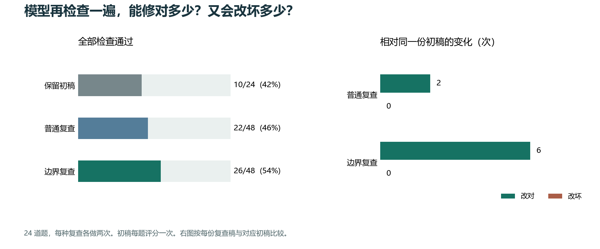

# 请模型再检查一次，能多修对几道仓颉题？

对同一批 24 份初稿，普通复查通过 **22/48** 次，点名空表、无效位置和提前返回后通过 **26/48** 次。保留初稿时有 **10/24** 题通过。边界提示比普通提醒多通过的 4 次全部来自同一类负数变号题，左右遍历各一题、每题两次。其余 22 题两种复查的通过次数相同。

## 怎样比较

选用上轮 24 道链表题，逐题取“按源码与题意选文档”策略的第一次回答。所有初稿都入组。新设计每题 18 组保留输入，432 条断言逐条检查函数返回值和操作后的完整链表。每道题的新输入都和该题以往的公开、保留输入核对过。用独立数组程序计算预期结果，再用原仓颉参考实现在 SDK 1.0.5 上复核。[预登记](protocol.md) · [初稿来源](starters.json) · [材料验收](https://github.com/Frank72316/cangjie-code-doctor/actions/runs/46118383394)

普通复查请模型重新检查运算、访问、状态变化和返回。边界复查点名空表、无效位置、端点及提前返回。两组都有相同的题意、初稿、文档及真实公开反馈，都允许保留原程序。每题每组独立请求两次，顺序均衡，温度为 0，关闭思考模式。评分时替换为冻结的测试入口，同时保留未通过公开检查的回答在分母中。[完整模型输入](design.json) · [模型答复](candidates.json) · [Linux 评分](https://github.com/Frank72316/cangjie-code-doctor/actions/runs/46119017052)

## 哪些程序得到改善

| 做法 | 最终通过 | 原先失败→通过 | 原先通过→失败 |
|---|---:|---:|---:|
| 保留初稿 | 10/24 | — | — |
| 普通复查 | 22/48 | 2 | 0 |
| 边界复查 | 26/48 | 6 | 0 |

“通过”要求源码通过编译、公开样例和全部新保留检查。初稿每题只评一次，每份复查稿都和同题初稿比较，因此两组各有 48 对结果。原先通过的 10 份初稿在两组两次复查后都通过。按预登记的 12 对题统计，边界复查在 2 对多通过，10 对持平。

| 初稿表现 | 初稿数 | 普通复查后通过 | 边界复查后通过 |
|---|---:|---:|---:|
| 通过全部检查 | 10 | 20/20 | 20/20 |
| 公开检查已失败 | 6 | 0/12 | 0/12 |
| 公开通过，但在新输入上失败 | 8 | 2/16 | 6/16 |

- **修对的例子。** 左、右两道整表负数变号题都要求返回修改次数。初稿遇到空表就返回 `-999`。普通复查均保留了这一行，边界复查四次都改为 `0`，并通过新测试。两组还都修对了“从标记向右找连续重复值”题，无处可找时按题意返回 `-1`。[逐题结果](summary.json) · [初稿与题意](transfer.json)
- **仍然失败的例子。** 整表向右交替加减题的初稿无法编译。两组复查都修好了遍历循环，也通过了公开样例，但都保留了空表时返回 `-999` 的分支。题目给出的累加初值是 `0`。明确提醒检查空表也会漏过这个错误。[初稿与题意](transfer.json) · [执行收据](score/receipt.json)

只看源码完全相同的情况，普通复查 37/48 次交回初稿，边界复查为 30/48 次。8 份“能过公开但漏掉新输入”的初稿各复查两遍，原样交回的次数分别是 12/16 与 8/16。同一提示重复两次时，两份源码完全相同的题分别有 22/24 和 23/24。重复运行的次数应与独立题数分开解读。

## 只在公开测试失败时复查，会怎样

用同一批答复回放三种产品规则。决定要不要调用、要不要采用时，只看当时能取得的公开结果。表里每种策略的总机会数均为 48，初稿直接保留也计入最终成绩。

| 使用规则 | 普通复查：调用 / 最终通过 | 边界复查：调用 / 最终通过 |
|---|---:|---:|
| 每次都用复查稿 | 48 / 22 | 48 / 26 |
| 每次复查，公开检查通过才采用 | 48 / 22 | 48 / 26 |
| 只复查初稿公开检查失败的题，通过公开检查才采用 | 12 / 20 | 12 / 20 |

只在公开检查失败时才调用，省下了 36/48 次调用，同时错过本轮所有能让程序从失败变为全部通过的修复。两种复查各有 12 份复查稿过不了公开检查。用公开检查把它们拦下来，最终全通过数仍相同。在“向左找位置并插入”的整表题里，两种复查都改错了插入方向，已通过的公开样例随之失败。回退到初稿可以保住这个公开样例，但初稿本身仍过不了保留检查。

## 失败集中在哪里

下表只统计通过公开检查、后来在保留检查失败的程序。按实际逐条输出分类，边界列指空表、标记为空或位置越界。初稿按题计，复查按调用计。两组各有 36 份复查稿进入了保留检查。[失败分类与对应题目](boundary-failures.json)

| 通过公开但未通过保留检查的源码 | 只在空表或无效位置失败 | 只在其他输入失败 | 两类都失败 | 无完整输出 |
|---|---:|---:|---:|---:|
| 初稿 | 8 | 0 | 0 | 0 |
| 普通复查 | 14 | 0 | 0 | 0 |
| 边界复查 | 10 | 0 | 0 | 0 |

当题目能明确推出一个边界行为，例如“空表修改零项”，值得把对应小输入真正跑一遍。口头提醒在同一类题上有收益，模型也可能照原样交回仍有缺陷的程序。用这类可执行反馈来驱动复查，需要另做对照实验。

## 范围、成本与复核

这批题由研究者编写，全部属于链表操作。边界提示来自上轮对同一批题的错误分析，本轮重新取了测试输入，题目与初稿仍沿用上轮。每种提示只有两次重复，均使用 DeepSeek Flash。结论只适用于该题集、模型与提示配置。学生使用效果、其他仓颉任务和其他模型仍需单独验证。测试观察返回值与链表最终顺序，无法据此评价时间复杂度或节点对象身份是否保持。

固定 SDK 共生成 96 份材料执行报告及 168 份复查稿执行报告。评分前遮盖组别，审阅 32 份去重源码。评分后逐一核对请求、源码、镜像及容器清理状态，再用独立的 Python 程序从原始收据复算转移、公开筛选效果和用量。[盲审记录](review.json) · [评分收据](score/receipt.json) · [逐题汇总](summary.json)

96 次真实调用合计输入 114,948 tokens，其中 73,462 命中缓存，输出 32,015。按实验统一采用的高峰无缓存口径，本轮约 0.486016 元，历轮累计约 6.541592 元。按当日周末定价和实测缓存量，本轮约 0.171015 元，实际扣费以账单为准。[DeepSeek 定价](https://api-docs.deepseek.com/zh-cn/quick_start/pricing/)

持有本地保留材料钥匙时可运行以下命令。

- `node scripts/check-review-fixtures.mjs --review` 核对新输入与期望结果。
- `node scripts/audit-api-evidence.mjs --review` 核对加密的执行证据。
- `node scripts/inspect-router-boundaries.mjs --review --verify` 复算失败输入分类。

用公开仓库材料即可运行以下命令。

- `node scripts/freeze-api-review.mjs --review --verify` 核对两组请求及调用顺序。
- `node scripts/summarize-api-review.mjs --review --verify` 和 `py scripts/check-review-outcomes.py` 分别从归档和评分收据复算结果。
- `py scripts/plot-api-review.py` 重画结果图。
