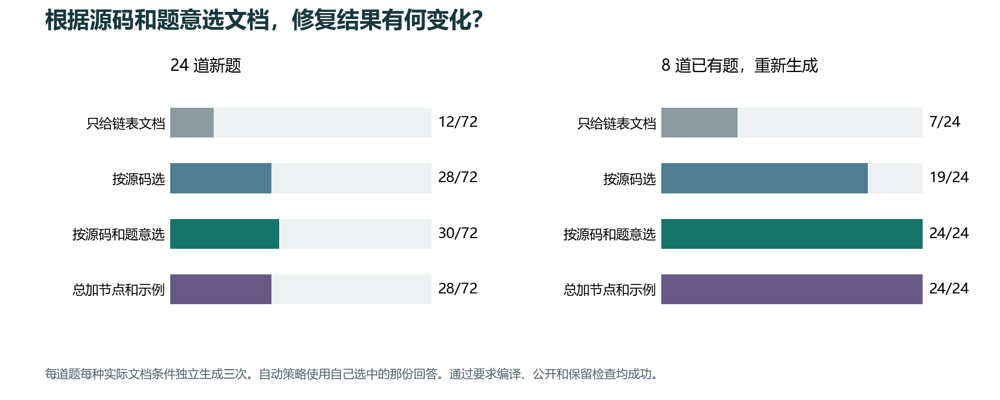

# Doctor 自动选择文档，能保留多少修复收益？

在 24 道新链表题上，按源码和题意选择补充文档通过 **30/72** 次，只给基础清单通过 **12/72** 次，只看源码和总是追加文档各通过 **28/72** 次。结合题意比基础清单多通过 18 次，来自 12 对题中的 7 对。它比总加文档多通过的 2 次全部来自一道题，同时少用 9,996 个输入 tokens，约 11.8%。在这批题上，节省输入的证据比提高最终通过数的证据更分散：策略在 14 道题上省去了补充文档。

## 为什么要做这项实验

上一轮给出了一个人工条件：链表节点的三个成员声明，加上一段处理可空值的示例。真实使用时，函数签名里即使出现了节点，题目也可能只要求统计整张表。本轮设置 12 对新题，每对共用完全相同的错误函数，一题关注给定位置，另一题从表的一端开始。6 类操作各有向左、向右两种方向，覆盖条件查找、查连续重复项、交替加减、修改奇数、负数变号和条件插入。另选 8 道已有题重新生成，用来观察熟悉任务的成绩。规则在新题编写前提交，规则和题集均由同一研究者完成。[预登记](protocol.md) · [选择规则](../../../scripts/route-node-evidence.mjs) · [公开题目](transfer.json)

**四种策略只会产生两种模型输入。** 基础输入是错误代码、题意、公开反馈和 26 条链表成员声明。另一种在此基础上补充节点属性卡及可空值示例。每题每种输入各实际生成三次。自动策略为每题从这两种输入中选一种，直接取该输入同次生成的回答及执行成绩。因此 32 × 2 × 3 共有 **192 次真实调用**；四种策略的回放共享这些候选。规则看不到分层标签、参考解、测试结果或文件名。生成模型能看到正常的源文件名和公开入口。题面和函数名均为研究材料。[冻结输入、调用顺序和策略决定](design.json) · [模型回答](candidates.json)

## 主要结果

新题的 72 次由 24 道题各做三次组成。每种策略在位置题和整表题各有 36 次。表中 tokens 只统计新题选中候选的实际使用量，策略之间的数字不能相加当成总账单。

| 策略 | 新题通过 | 位置题通过 | 整表题通过 | 输入 tokens | 输出 tokens | 已有题通过 |
|---|---:|---:|---:|---:|---:|---:|
| 只给链表清单（L） | 12/72 | 4/36 | 8/36 | 67,806 | 29,363 | 7/24 |
| 只按源码选择（S） | 28/72 | 22/36 | 6/36 | 79,230 | 24,429 | 19/24 |
| 按源码与题意选择（J） | 30/72 | 22/36 | 8/36 | 74,946 | 24,233 | 24/24 |
| 总加两份文档（A） | 28/72 | 22/36 | 6/36 | 84,942 | 24,078 | 24/24 |

只看源码时，每对新题都会收到相同的文档决定。在 12 道位置题里它给 8 道加了文档，在 12 道整表题里也给 8 道加了文档。结合题意后依然为 8 道位置题补文档，但整表题减至 2 道。剩下 4 道位置题被遗漏，对应下标定位的负数变号与插入操作；选文档的源码和用词线索偏弱。这 4 道题中，直接比较两种候选输入，观察到的通过次数逐题相同。相对于分层的漏选和实际修复损失应分别计算。[逐题成绩与选择](summary.json)

| 新题两策略比较 | 净多通过次数，分母 72 | 12 对题中改善 / 持平 / 下降 |
|---|---:|---:|
| J-L | +18 | 7 / 5 / 0 |
| J-A | +2 | 1 / 11 / 0 |
| S-L | +16 | 6 / 6 / 0 |
| S-A | 0 | 0 / 12 / 0 |
| J-S | +2 | 1 / 11 / 0 |

| 新题操作，每格分母 6 | L 基础 | S 只看源码 | J 源码和题意 | A 总加文档 |
|---|---:|---:|---:|---:|
| 阈值查找（向左） | 0 | 3 | 3 | 3 |
| 阈值查找（向右） | 3 | 3 | 5 | 3 |
| 查连续相同项（向左） | 0 | 2 | 2 | 2 |
| 查连续相同项（向右） | 0 | 0 | 0 | 0 |
| 交替加减（向左） | 0 | 3 | 3 | 3 |
| 交替加减（向右） | 0 | 3 | 3 | 3 |
| 修改两个奇数（向左） | 3 | 5 | 5 | 5 |
| 修改两个奇数（向右） | 3 | 6 | 6 | 6 |
| 负数变号（向左） | 0 | 0 | 0 | 0 |
| 负数变号（向右） | 3 | 3 | 3 | 3 |
| 条件插入（向左） | 0 | 0 | 0 | 0 |
| 条件插入（向右） | 0 | 0 | 0 | 0 |

## 文档什么时候帮忙，什么时候添乱

**要改光标左侧的两个奇数时，节点属性有用。** 在这道题的基础清单组中，模型的一份回答会沿着迭代器找到奇数，最后增加了计数，却漏掉写回数值。另一组拿到了节点声明，回答直接用 `prev` 移动，再给 `value` 赋新值。两组的实际通过数是 1/3 和 3/3。用例既查返回计数，也查整表内容。[原始回答](candidates.json) · [执行评分](score/receipt.json)

**多给文档也可能让模型保留错误的限制。** “从左端查第一个达标值”明确要求忽略传入位置。J 选择了基础清单，3/3 通过；总加文档时只有 1/3。两份未通过保留检查的程序在标记为空时提前返回，即使非空链表中有达标值也会漏报。J 相对 A 的全部净增来自这里，其他 11 对题均持平。提示可能影响修法，单题的独立生成不足以判定具体哪句话导致了错误。[逐次判定](verified.json)

**比文档选择更大的缺口是边界行为。** 在全部 192 份回答中，4 份因 JSON 对象后有多余文字失败，21 份编译失败，42 份未通过公开测试。余下 125 份通过公开检查，其中 54 份在保留检查被淘汰，最终 71 份通过。新题贡献了这 54 份中的 52 份。事后逐条读取执行结果，**47/52** 的失败只发生在空表或无有效位置的输入，另外 5 份只在表非空且位置有效时出错。例如向右查找并插入的一道整表题，模型能正确调用插入方法，却保留了原代码在空表时返回 `-999` 的分支，契约要求返回 `-91`。这里的“只在”限于本次执行的输入。[边界复核](boundary-failures.json) · [隔离评分](https://github.com/Frank72316/cangjie-code-doctor/actions/runs/46112206477)

## 改写题意后，规则稳定吗？

在候选锁定后、隔离成绩揭盲前，另写了 24 份范围和方向改述。每道新题只换开头，保留具体操作和返回要求。只让选择规则看改述，模型生成仍使用原题，属于额外的文档选择敏感性分析。24 道中有 **12 道改变选择**；同批候选回放的通过次数从原来的 **30/72** 变为 **28/72**，输入 tokens 从 74,946 增至 80,658。改述同样由研究者编写，尚未测量学生真实改写后端到端的生成表现。[改述与原选择](scope-paraphrases.json) · [回放成绩](scope-replay.json)

## 结论与局限

在这批混合任务上，节点声明和示例带来了可复现的修复机会。固定规则利用题意，能够用更短的输入取得接近总给文档的成绩。已有题上 J 和 A 均达 24/24，新题上分别只有 30/72 和 28/72。新题特意设置相同代码对应不同操作范围，原程序还带有错误的哨兵返回值；公开样例均为非空且位置有效。这些选择使边界缺陷更容易留到保留检查才暴露。分层指任务是否依赖位置，整表操作也可能用到节点 API。策略只在这一个库类型、一个模型和固定 SDK 上检验，尚未部署到工作台。下一项值得独立验证的是，在模型首次修正后只提示它检查空表和无效位置，并用另一批未见测试确认修复是否真正改善。

## 核验与费用

材料包含 64 组公开输入和 332 组保留断言。验收前曾发现导出脚本遗漏正向越界输入，已在生成候选前更正冻结并记录。全部 32 道题原程序两套检查失败，参考程序两套均通过；128 份材料执行报告已复核。SDK 1.0.5、DeepSeek Flash、温度 0 和每次输入在调用前锁定。188 份有效格式候选通过静态测试入口检查，另 4 份保留在分母。遮盖组别后检查 130 份不同完整源码的导入、主函数、分支及字面量，并复读被标出的源码。Linux 容器生成 313 份候选执行记录，另用独立 Python 程序从原始收据复算四种策略、两个题集及五项配对差值。[材料验收](https://github.com/Frank72316/cangjie-code-doctor/actions/runs/46111212853) · [盲审记录](review.json) · [评分运行](https://github.com/Frank72316/cangjie-code-doctor/actions/runs/46112206477)

北京时间 2026-11-28 13:21–13:26 共调用 192 次。输入 200,694 tokens，其中缓存命中 140,643；输出 69,690 tokens。高峰无缓存口径估算本轮 0.958908 元，历轮累计 6.055576 元。按周末空闲价和实际缓存量重算，本轮约 0.341624 元，实际扣费以账单为准。[DeepSeek 定价](https://api-docs.deepseek.com/zh-cn/quick_start/pricing/)

在仓库根目录运行以下离线命令可核对归档。

- `node scripts/freeze-api-router.mjs --router --verify` 核对请求与策略。
- `node scripts/summarize-api-router.mjs --router --verify` 复算主结果与用量。
- `node scripts/probe-router-paraphrases.mjs --router --verify` 与 `node scripts/replay-router-paraphrases.mjs --router --verify` 核对改述及回放。
- `node scripts/audit-api-evidence.mjs --router` 和 `node scripts/inspect-router-boundaries.mjs --router --verify` 使用本地保留材料钥匙核对原始执行证据和边界统计。
- `py scripts/plot-api-router.py` 重画成绩图。
- `py scripts/check-router-replay.py` 从评分收据独立重算四种策略，核对输入用量、配对差值及总费用。
