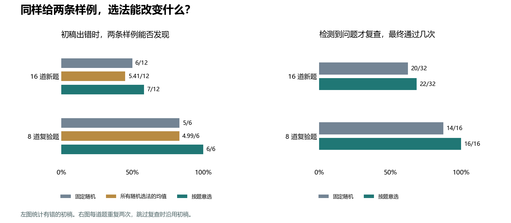

# 同样给两条样例，怎样选更容易发现错误？

在 16 道新题上，12 份初稿有错。两条固定随机样例发现 6 份，按题意选的两条发现 7 份。让模型复查所有新题，随机组最终通过 32/32 次，按题意选例组通过 32/32 次。按样例失败与否决定是否调用模型，最终分别通过 20/32 和 22/32 次。

## 怎样选两个样例

主样本包含 16 道新数组题，覆盖最长连续区间、按限额修改、相邻元素跨越阈值、双标记窗口四类，每类四题。每类有一份正确初稿，其他初稿植入了真实可执行的逻辑错误。另取上一轮的全部 8 道数组题作为复验样本。两个题集分别报告。

每题的候选池相同，共 24 个长度均为 5、阈值均为 2 的数组。U 组用事先锁定的种子，无放回随机抽两条。D 组先列出正确题意和四种可能的不同理解，再枚举 276 个输入对，优先让更多不同理解与正确行为产生不同输出。并列时，优先选择也能区分不同错误理解的输入对，最终按固定哈希打破平局。返回值和修改后的完整数组都计入比较。选例发生在运行初稿之前。[预登记](protocol.md) · [选择程序](../../../scripts/select-contract-examples.mjs) · [每道题选中的输入](selection.json)

先在仓颉 SDK 1.0.5 中运行初稿和参考程序，取得整个候选池的真实输出。模型只能看到分给它的两条样例，每条都含输入、期望和初稿实测值。题意、源码、原公开反馈、模型与参数在两组间一致。每组每题独立请求两次，第二遍倒序。生成后先遮盖组别审阅，再把每份回答放入隔离容器。主评分要求通过编译、原公开样例和该题全部 24 条保留检查。整池输入与保留输入均按题去重。[材料验收](https://github.com/Frank72316/cangjie-code-doctor/actions/runs/46124905577) · [模型请求](design.json) · [评分运行](https://github.com/Frank72316/cangjie-code-doctor/actions/runs/46125781179)

这次对照只改变送给模型的两条运行样例，所有请求都没有附加官方文档。文档检索本身的效果见项目的[正式文档对照](../2026-11-26-challenge/formal/report.md)。

## 两条样例发现了多少份错误初稿

原来的两条公开样例在所有初稿上都通过。独立保留测试发现新题中 12 份有错、复验题中 6 份有错，因此下表的检出数也是新增发现数。两种方法对六份正确初稿的误报数均为零。

| 题集 | 有错初稿 | 固定随机 U 检出 | 均匀抽两条的精确期望 | 按题意 D 检出 |
|---|---:|---:|---:|---:|
| 新题 | 12 | 6 | 5.41 | 7 |
| 复验题 | 6 | 5 | 4.99 | 6 |

精确期望使用每题 24 个实际输出，遍历所有 276 种无放回选法后求和，保留小数。假设每题独立均匀抽取两条，在这批新题上随机检出至少 7 份的概率约为 23.2%。这个概率只描述当前候选池。同一批题逐次移除一个候选输入再选，24 次检查中新题 D 相对随机期望多检出 1.44–1.74 份。[逐题检出与随机基线](detection.json) · [候选池敏感性](sensitivity.json)

**收益取决于事先考虑了哪些错误。** 新题有 7 份错误与所列的竞争解释一致，D 检出 6 份，固定 U 检出 4 份。另外 5 份错误来自未列入的实现缺陷，D 只检出 1 份，U 检出 2 份。后者包括从右往左扫描时漏掉索引 0。随机组选中一个只有首元素符合条件的数组，定向组的两条样例都没有暴露它。研究者同时设计了题目、初稿及竞争解释，这项分层尤其重要。[故障标签](fault-labels.json) · [初稿与参考程序的实测结果](materials/receipt.json)

复验中的“只改第一个”给出了一个直观的正例。对于数组 `[2, -3, 6, 4, 2]` 和阈值 `2`，返回下标都为 `2`，但正确的最终数组是 `[2, -3, 2, 4, 2]`，初稿却把后面的 `4` 也改成了 `2`。只检查返回值会看漏这个错误。

在 12 份有错的新题初稿中，两种方法共同发现 5 份，只有定向组发现的有 2 份，只有固定随机组发现的有 1 份，两边都漏掉 4 份。[逐题检出对照](detection.json)

## 发现以后，模型能修好吗？

实际调用使用 `deepseek-flash`，温度为 0，每个“题目 × 选法”提交两次。下表的修复率只以原本有错的初稿为分母。“原本正确却改错”只看正确对照。“样例通过但全测失败”用于检查学生只看眼前两条绿勾时可能漏掉的错误。[逐次修复与样例成绩](traces.json) · [隔离评分收据](score/receipt.json)

| 题集 | 选法 | 错误初稿修好 | 原本正确却改错 | 全部通过 | 样例通过但全测失败（次） |
|---|---:|---:|---:|---:|---:|
| 16 道新题 | 固定随机 | 24/24 | 0/8 | 32/32 | 0 |
| 16 道新题 | 按题意选 | 24/24 | 0/8 | 32/32 | 0 |
| 8 道复验题 | 固定随机 | 12/12 | 0/4 | 16/16 | 0 |
| 8 道复验题 | 按题意选 | 12/12 | 0/4 | 16/16 | 0 |

48 个“题目 × 选法”中，有 40 个两次返回的源码逐字节相同。两次请求用于观察本轮配置下的重复性。题目才是比较两种策略的单位。[候选源码及实际用量](candidates.json)

## 如果只在发现错误时调用模型

实测时每组都调用了模型。下表在同一批回答上回放预先锁定的使用规则，检查原公开样例与两条新样例。都通过就沿用初稿，出现失败才取该次模型回答。最终判定仍然使用当时用户看不到的保留测试。[冻结规则](protocol.md) · [逐题分母和回放明细](summary.json)

| 题集 | 选法 | 需调用次数 | 最终全部通过 | 估算模型费（元） |
|---|---:|---:|---:|---:|
| 16 道新题 | 固定随机 | 12/32 | 20/32 | 0.0403 |
| 16 道新题 | 按题意选 | 14/32 | 22/32 | 0.0475 |
| 8 道复验题 | 固定随机 | 10/16 | 14/16 | 0.0277 |
| 8 道复验题 | 按题意选 | 12/16 | 16/16 | 0.0335 |

初稿原封不动时，新题两遍合计只有 8/32 次通过，复验题为 4/16。固定随机与定向选例在新题上分别触发 12、14 次复查。这批新题的两种反馈在全面复查时都达到满分，实验能观察到的差异出现在触发复查的环节。

## 原来的 24 条都测不出来时怎么办？

有一道“找第一次向下跨过阈值”的题。原池里每个输入都让“第一次”和“最后一次”返回相同位置，换遍 276 个输入对也发现不了这一处错误。我们在材料验收之后单列了补充实验。在六个可能的数值、长度固定为 5 的 7,776 个数组中，搜索能区分原池尚未区分的题意的输入。每题的评分准则和交给程序的两条上限均维持原样。扩充前的选择与模型候选已锁定。补充试验只运行参考程序和初稿。[补充输入及更换清单](supplement.json) · [隔离执行输出](score/supplement.json)

共加入 9 个按题计的候选输入，8 道题更换了最终的两条样例。新题检出数从 7/12 变为 8/12（新增 1 份、丢失 0 份），复验题从 6/6 变为 6/6（新增 0 份、丢失 0 份）。两批题的正确初稿共出现 0 次误报。具体改变最终检出结果的有 `cross_first_down`。例如，`[4, 0, 6, -1, -3]` 在下标 0 和 2 都从大于 2 降到小于 2。参考程序实测返回 0，错误初稿返回 2。新增样例只检验了错误能否暴露，它对模型修复的影响仍待用独立材料验证。[补充统计](witness-summary.json)

## 证据、费用与解释范围

仓颉 SDK 1.0.5 产生 144 份材料执行报告、288 份候选执行报告，另为 8 个改选的输入对产出 16 份补充执行报告。候选在组别遮盖状态下审阅。Python 使用另一份题意实现，独立核对两种策略的选择、参考输出、候选成绩及按需调用统计。相同题目中，相同源码得到一致的最终判定。[材料收据](materials/receipt.json) · [评分收据](score/receipt.json) · [独立复算脚本](../../../scripts/check-selection-study.py)

本轮实际输入 64,422 tokens（其中 34,279 命中缓存），输出 21,790 tokens。按历轮统一的输入每百万 2 元、输出每百万 8 元估算，本轮 **0.303164 元**，项目累计 **7.707732 元**。按实验当日周末价和实际缓存命中量，本轮约 0.117989 元。实际扣费以平台账单为准，估算只含模型调用。[DeepSeek 官方定价](https://api-docs.deepseek.com/zh-cn/quick_start/pricing/)

主样本只有四类研究者编写的数组题，题意、备选理解及正确输出都由研究者提供。这里验证了工具在已知题意下选择样例的能力。真实学生的错误分布、学生能否给出同样可靠的期望，以及在其他模型上的表现，均需独立评估。

## 复算

在仓库根目录可运行下列命令。Python 独立实现了契约、成对评分、哈希决胜及随机抽样，随后从执行收据重算模型成绩与按需费用。

- `py scripts/check-selection-study.py` 核对两种选例、每题 276 对、96 次修复及收费估算。
- `node scripts/freeze-selection-study.mjs --selection --verify` 核对冻结请求，`node scripts/analyze-selection-detection.mjs --selection --verify` 重算检出结果。
- `node scripts/selection-sensitivity.mjs --selection --verify` 重算移除输入与错误类型分层，`node scripts/summarize-selection-study.mjs --selection --verify` 复算最终结果。
- `py scripts/plot-selection-study.py` 重画结果图。

持有本地保留材料钥匙时，运行 `node scripts/check-selection-fixtures.mjs --selection`、`node scripts/audit-api-evidence.mjs --selection`、`node scripts/summarize-selection-study.mjs --selection --traces --verify` 可核验材料、底层执行记录、所选样例与整池成绩。`node scripts/expand-selection-pool.mjs --selection --verify` 和 `node scripts/run-selection-witnesses.mjs --selection --verify` 可核验补充实验的输入和真实输出。

公开补充统计可用 `node scripts/summarize-selection-witnesses.mjs --selection --verify` 复核。
